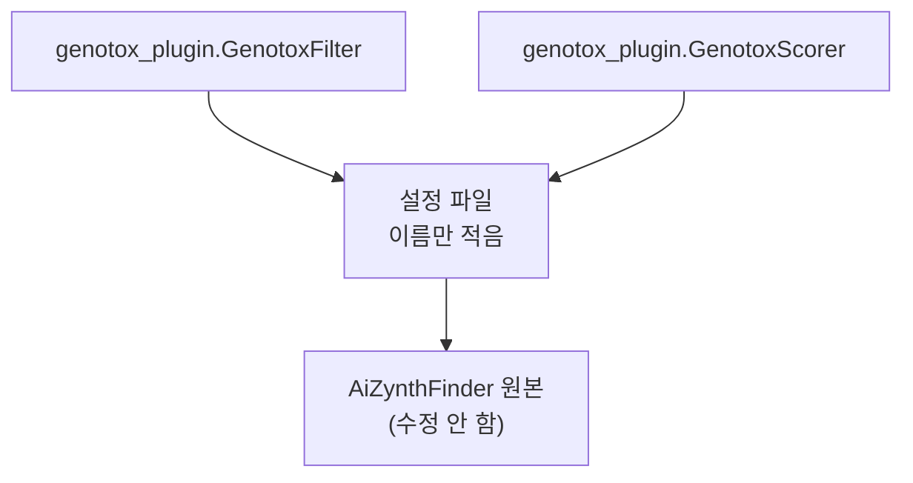
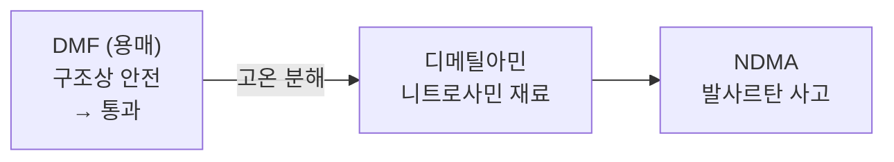

# 유전독성·발암성 물질이 나오지 않는 합성 경로 제안

예빈 | 2026-09-28 | 테스트 상세는 별도 페이지, 논문은 `논문/` 폴더

---

| | AiZynthFinder만 | 검사기를 붙이면 |
|---|---|---|
| 나오는 경로 | 8개 | 5개 |
| 위험 표시 | 없음 | Epichlorohydrin 하루 3 µg |
| 빠지는 경로 | | 3개 (위험 시약 사용) |

---

## 1. 선행연구

SynCraft (2026, *Nucleic Acids Research*). 같은 발상의 웹사이트.

| 질문 | SynCraft | 우리 |
|---|---|---|
| DNA를 망가뜨리나 | 위험 신호 있음 | Ames 시험 양성 확률 |
| 몇 µg까지 되나 | 답 없음 | 하루 3 µg |
| 시약·부산물도 봤나 | 중간체만 | 중간체 + 시약 + 부산물 |
| 어느 경로로 만드나 | 답 없음 | 위험한 3개 뺀 5개 |

예측기 1개만 사용, 허용량 미산출. 규제 기관 제출 불가.

---

## 2. 설계

### 2.1 AiZynthFinder에 붙이는 방식

| | `filter` | `scorer` |
|---|---|---|
| 하는 일 | 경로 삭제 | 감점, 경로는 유지 |
| 보는 범위 | 반응 한 단계 | 경로 전체 |
| 쓰는 곳 | 절대 금지 물질 | 정도 차이가 있는 위험 |
| 순위 매기기 | 불가 | 가능 |

경로 탐색 엔진 제작 불필요. AiZynthFinder 업데이트 시에도 유지.

### 2.2 예측기 두 개

ICH M7은 컴퓨터 예측이 "안전"이면 Ames 실험 면제. 조건은 원리가 다른 프로그램 두 개가 모두 "안전" 판정.

| | 판정 방식 | 놓치는 것 | 쓸 것 |
|---|---|---|---|
| 규칙 | 위험 구조 목록과 대조 | 목록에 없는 물질 | Toxtree |
| 데이터 | Ames 7,255건 학습 모델 | 학습에 없던 구조 | ADMET-AI |

놓치는 지점이 서로 다르므로 병행. SynCraft는 하나만 사용.

> Toxtree·ADMET-AI 연동은 미착수. 현재 테스트는 ICH M7 목록 대조와 구조 검사로 진행.

### 2.3 허용량 계산

| 물질 | 하루 허용량 |
|---|---|
| 아세트알데히드 | 2000 µg |
| Epichlorohydrin | 3 µg |

667배 차이. ICH M7이 위험 물질 약 20종의 허용량을 표로 지정. 경로에 나온 물질을 이 표와 대조.

### 2.4 시약·부산물 검사

| 위치 | 사고 사례 |
|---|---|
| 시약 | Epichlorohydrin, Glycidol, Hydrazine. ICH M7 목록에 있으면서 흔히 쓰는 시약 |
| 중간체 | 사르탄(2021). 테트라졸 고리 형성에 쓴 아자이드가 남아 AZBT 생성, 여러 나라 회수 |
| 부산물 | Viracept(2007). 정제 용매 에탄올이 메실산과 반응해 EMS가 허용치 700배 생성, 전 세계 회수 |

부산물은 AiZynthFinder 미출력. ASKCOS(MIT, 무료)가 예측.

| ASKCOS 부산물 유형 | 이 유형으로 생긴 사고 |
|---|---|
| 용매 부가물 | Viracept / EMS (2007) |
| 용매 부가물 | 설포네이트 에스터. 메실산 염을 메탄올로 정제하면 생성. 용매를 바꾸면 생기는 물질도 바뀜 |
| 부차 생성물 | AZBT / 사르탄 (2021) |
| 과반응·이량화 | 테스트 1에서 아세트알데히드 검출 |

ASKCOS는 위험 여부 미평가. 논문 전문에서 "hazard", "safety" 검색 0건.

---

## 3. 테스트

| 확인한 것 | 결과 |
|---|---|
| 부산물 수집 | ASKCOS 공개 서버에서 5개, 유형까지 |
| 위험 물질 선별 | 아세트알데히드 검출, 허용량 2000 µg/day 산출 |
| 목록과 구조 검사의 차이 | NDMA는 구조 검사로만 검출. 허용량은 목록에만 있음 |
| 코드 수정 없이 연동 | 설정 파일에 이름만 적어서 등록 |
| 경로 내 위치 반영 | 같은 물질이 마지막 단계 0점, 다섯 단계 앞 0.667점 |
| 실제 경로 필터링 | 아래 |
| 과거 사고 검출 | 발사르탄 공정 물질 입력 시 니트로사민 경고 |
| 노트북 실행 | ASKCOS는 공개 서버라 설치 불필요 |

### 실제 경로 필터링

프로프라놀롤. 공장에서 실제로 Epichlorohydrin을 쓰는 약.

| | 경로 | 차단된 반응 |
|---|---|---|
| `filter` 끔 | 8개 | |
| `filter` 켬 | 5개 | 58건 |

| 차단 사유 시약 | 하루 허용량 | 비고 |
|---|---|---|
| Epichlorohydrin | 3 µg | 예상함 |
| Glycidol | 4 µg | 예상 못 함. Epichlorohydrin이 물과 반응하면 생성 |

경로 전부 소멸은 아님. 8개 중 3개만 제외.

### 못 잡는 것

현재 구조만 판정. 이후 변화는 미반영.

| | |
|---|---|
| 구조 검사에만 걸린 물질은 잔존 | 남은 5개 경로 중 4개에 알킬 할라이드·에폭사이드. `scorer`가 다루도록 설계 |
| 목록·규칙이 작음 | ICH M7 목록 15종 시험용. 알킬 할라이드 규칙은 1급만 |

---

## 4. 회의 안건

> **① 부산물을 어디까지 볼 것인가**
>
> | 안 | 대상 |
> |---|---|
> | 가 | 출발물·중간체·시약 |
> | 나 | 가 + ASKCOS 부산물 예측 |
> | 다 | 니트로사민만 |
>
> "나"안의 사양 문제는 공개 서버로 해결. 남은 제약은 ②.

> **② 반응 조건 확보 방법**
>
> ASKCOS가 용매 부가물을 예측하려면 용매 정보 필요. AiZynthFinder는 미출력. 용매 정보 없으면 Viracept(EMS) 같은 사고 검출 불가.
>
> ASKCOS 조건 추천 기능 있으나 공개 서버 호출 실패.

> **③ 규제 수준을 주장할 것인가**
>
> | | 장점 | 단점 |
> |---|---|---|
> | 규제 수준 주장 | 의미가 큼 | 무료 도구는 검증 문서 부족 |
> | 초기 선별 도구 | 방어 쉬움 | 의미 축소 |

> **④ 얼마나 세게 걸러낼 것인가**
>
> | 강도 | 남는 경로 | 문제 |
> |---|---|---|
> | 지금 (목록만 차단) | 5개 | 4개에 경고 잔존 |
> | 더 세게 (구조 검사도) | 1개일 수 있음 | 경고 없는 경로는 하나뿐 |
>
> 위양성 감소 방안: ICH M7 목록 물질 우선 처리 / 앞 공정 불순물의 후속 제거분 감안(purge factor) / 경로 뒤쪽 물질 가중치 하향.

---

## 5. 한계

| 항목 | 내용 |
|---|---|
| 부산물 정답지 없음 | 특허 반응식 중 양쪽 원자 수가 맞는 것은 4.8%. 부산물 미기재가 원인. 정확도를 목표 지표로 사용 불가 |
| 위양성 다수 | Toxtree는 안전한 물질 100개 중 34개를 위험으로 판정. 안건 ④ |
| 구조 외 요인 미검출 | 발사르탄 사고는 물질이 아니라 반응 조건이 원인 |
| 발암성 예측 데이터 부족 | ADMET-AI 발암성 모델은 학습 278건. 데이터 쪽은 Ames(7,255건)만 사용, 발암성은 규칙·목록에 의존 |

---

## 부록 A. ICH M7 등급

| 등급 | 어떤 물질 | 관리 | 계산만으로 |
|---|---|---|---|
| 1 | 발암성이 실험으로 확인됨 | 개별 한도 | 불가 (문헌) |
| 2 | DNA 손상까지만 확인됨 | 하루 1.5 µg | 불가 (문헌) |
| 3 | 위험 구조 있으나 미확인 | 하루 1.5 µg 또는 실험 | **가능** |
| 4 | 주성분과 같은 구조, 주성분이 안전 판정 | 문제없음 | 불가 (실험) |
| 5 | 위험 구조 없음 | 문제없음 | **가능** |

## 부록 B. 출처

| 구분 | 출처 |
|---|---|
| 규제 | ICH M7(R2) Step 4 (2023) · EMA 사르탄 조사보고서 EMA/217823/2019 · EMA 니트로사민 허용량 표 |
| 선행연구 | SynCraft, *Nucleic Acids Research* 2026, 54(W1):W57 · ASKCOS, *Acc. Chem. Res.* 2025, DOI 10.1021/acs.accounts.5c00155 · CompleteRXN, arXiv:2605.00222 |
| 사고 | Viracept/EMS: *AIDS Res Ther* 6:18 (2009) · AZBT/사르탄: EDQM, Health Canada 회수 공지 (2021) · 설포네이트 에스터: *Chemistry World* |
| 프로그램 | AiZynthFinder https://github.com/MolecularAI/aizynthfinder · Genheden et al., *J Cheminform* 12, 70 (2020) · Saigiridharan et al., *J Cheminform* (2024) |
| 도구 | Toxtree v3.1.0 (2018). 오판율 출처 *Regul Toxicol Pharmacol* 2013 · ADMET-AI, *Bioinformatics* 2024 |
| 데이터 | TDC AMES (7,255건) |
