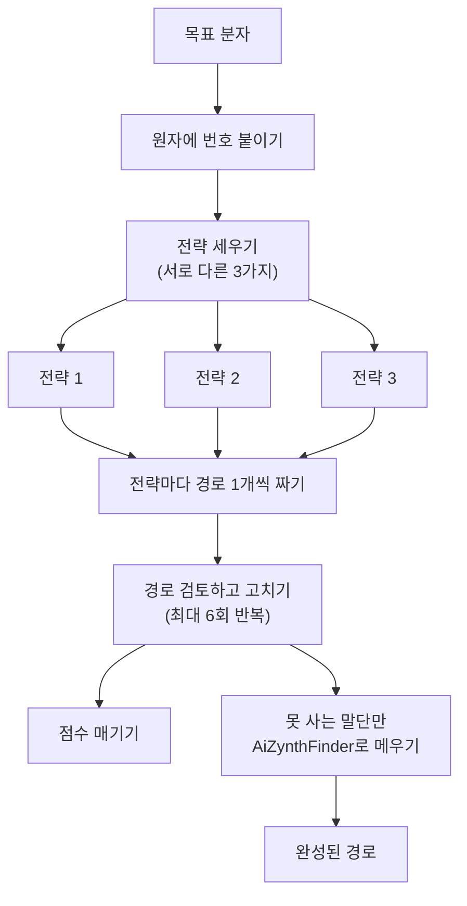
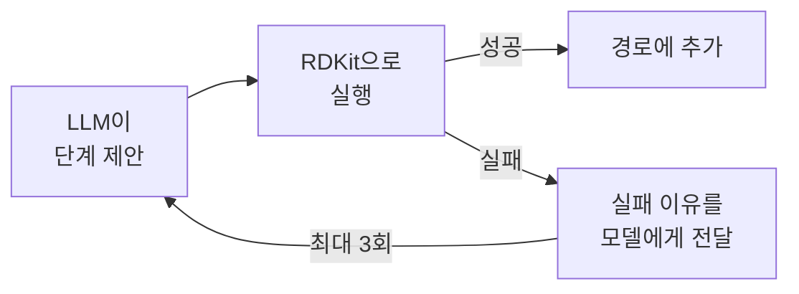
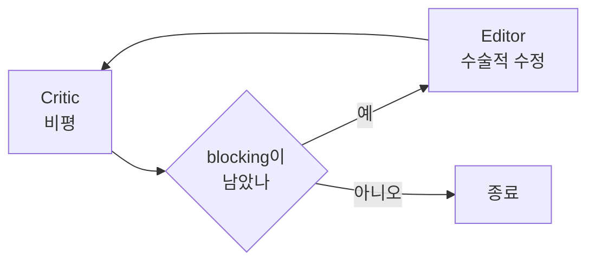

# SynthEx 코드 분석

예빈 | 2026-10-04 | 소스: https://github.com/schwallergroup/synthex (submission 브랜치)

---

## 1. 소프트웨어 개요

EPFL LIAC(Philippe Schwaller 그룹)에서 만든 역합성 도구. MIT 라이선스. 논문은 arXiv:2608.07454 프리프린트. 커밋 9개의 논문 제출용 스냅샷이고, **코드는 submission 브랜치에만 있음.** main에는 README뿐.

목표 분자를 넣으면 거꾸로 올라가며 합성 경로를 짬. 여기까지는 AiZynthFinder와 동일. 다른 점은 **분해 방법을 정하는 방식**.

| | 기존 방식 (AiZynthFinder 등) | SynthEx |
|---|---|---|
| 분해 결정 | 반응 템플릿 목록에서 **고름** | LLM이 그래프 편집 명령을 **씀** |
| 한계 | 템플릿에 없는 반응은 못 씀 | 템플릿 제약 없음 |
| 원자 매핑 | 나중에 별도 도구로 붙임 | 만드는 과정에서 자동 보존 |

### ReactionJSON

핵심 아이디어. 분해를 **원자 단위 편집 명령 목록**으로 표현. 명령은 10가지뿐임. 결합 끊기·만들기·차수 바꾸기, 원자 종류 바꾸기, 작용기 붙이기·떼기, 수소 지정, 입체중심 뒤집기·지우기, 이중결합 입체 지정.


**모델은 전구체 SMILES를 직접 쓰지 않음.** 편집 명령만 쓰고 전구체 구조는 RDKit이 계산. 모델이 없는 구조를 적어낼 여지가 줄고 원자 매핑이 저절로 유지됨.

---

## 2. 전체 흐름



| 담당 | LLM | 산출물 |
|---|---|---|
| StrategyGenerator | 사용 | `strategies.json` |
| RouteBuilder | 사용 | `routes.json` |
| Critic, Editor | 사용 | `reviewed_routes.json` |
| Analyst | 사용 | `analyses.json` |
| AiZynthFinder 호출 | **미사용** | `stitched_routes.json` |

점수 매기기와 말단 메우기는 서로 독립. 둘 다 검토 결과만 씀.

마지막 단계가 요점. LLM이 짠 전략 경로의 말단에 **살 수 없는 물질**이 남으면 거기서부터 AiZynthFinder의 템플릿 탐색으로 메움. 전략 부분은 건드리지 않음.

---

## 3. 핵심 설계 세 가지

LLM 출력을 믿지 않는 구조가 이 소프트웨어의 요점.

### 3.1 제안을 실제로 실행해 보고 받아들임

RouteBuilder는 LLM이 낸 단계를 바로 쓰지 않음. RDKit으로 **실제로 돌려 보고** 성공해야 경로에 넣음.



`src/synthex/agents/route_builder.py:42-89`

```python
candidate = route.model_copy(update={"steps": [*route.steps, step]})
render_plan(candidate.to_op_plan())        # 여기서 실제 실행
except ValueError as exc:
    previous_error = describe_validation_error(exc)   # 실패 이유를 모델에게
    continue                                           # 다시 제안받기
route = candidate                                      # 성공해야 수락
```

원시 오류 메시지를 그대로 주면 모델이 같은 실수를 반복해 예산을 다 태웠다는 관찰 기록이 주석에 있음. 그래서 오류를 다듬어서 넘김.

### 3.2 원자 수를 코드가 세어 모델에게 들이댐

`src/synthex/routejson/accounting.py` 주석이 설계 동기를 직접 설명.

> Critic 프롬프트는 늘 모델에게 원자를 세라고 요구했다. 모델은 세었다고 주장하면서도 조각이 빠지거나 입체중심이 뒤집힌 전구체를 통과시켰다.

그래서 **RDKit이 직접 셈.** 원소별 중원자 수, 입체중심 수, 입체 이중결합 수를 세어 Critic 프롬프트에 집어넣고, 이 숫자를 다시 세는 것을 금지. Critic의 역할이 "세기"에서 "불균형이 화학적으로 정당한지 판정"으로 바뀜.

| 상황 | 판정 |
|---|---|
| 전구체에 원자가 남음 (SURPLUS) | 정상. 이탈기, 축합 부생성물, 보호기 |
| 전구체에 원자가 모자람 (MISSING) | 위험. 시약이 공급하는 경우만 허용 |
| 입체중심 수가 줄어듦 | 편집 명령이 입체화학을 뭉갠 것. 의도 여부 판정 필요 |

### 3.3 비평하고 고치는 루프

`src/synthex/pipeline.py:273-308`



최대 6회 반복. 문제 단계가 없거나 `blocking` 지적이 하나도 안 남으면 종료.

Editor는 도구를 쓰는 에이전트. 경로 읽기, 편집 명령 실행해 보기, 수정 이력 보기, 특정 시점으로 되돌리기, 문자열 치환, 제출. `submit`은 **렌더링에 성공해야만** 통과하므로 깨진 경로는 구조적으로 제출 불가.

---

## 4. 코드 읽는 순서

| 역할 | 위치 |
|---|---|
| CLI | `cli.py:613` `main()` |
| 조립 | `application.py:11` `create_pipeline()` |
| 전체 오케스트레이션 | `pipeline.py:329` `SynthexPipeline.run()` |
| 경로 구성 | `agents/route_builder.py:42` `RouteBuilder.run()` |
| 비평 루프 | `pipeline.py:256` `_review_one_route()` |
| 편집 실행기 | `reactionjson/executor.py:62` `execute_ops()` |
| 말단 완성 | `completion.py:126` `complete_route()` |

디렉터리는 `agents/`(LLM 에이전트 5개), `prompts/`(버전이 박힌 프롬프트 737줄), `reactionjson/`(분해 하나), `routejson/`(여러 단계를 이은 경로)로 나뉨. Gemini를 쓰는 파일과 AiZynthFinder를 쓰는 파일은 `integrations/` 안에 각각 하나뿐임. 화학 로직 쪽은 둘 다 import하지 않아서 **API 키 없이 전체 테스트 가능.**

### 읽을 만한 코드 한 토막

어느 분자를 분해할지 정하는 부분. `routejson/executor.py:171-183`

```python
req_maps = _required_map_ids(ops)

# 이 매핑 번호들을 가진 프런티어 분자를 찾는다
product_idx = None
for i, mol_node in enumerate(frontier):
    if req_maps.issubset(_maps_in(mol_node["_mapped_smi"])):
        product_idx = i
        break
```

각 단계는 어느 분자를 분해하는지 **명시하지 않음.** 편집 명령이 참조하는 원자 번호를 모두 가진 분자를 찾아 그것을 생성물로 삼음. 이 설계 덕분에 경로가 평면 텍스트인데도 가지치는 트리를 표현 가능.

---

## 5. AiZynthFinder와 비교

SynthEx는 AiZynthFinder를 경쟁자가 아니라 **부품으로 씀.**

| 항목 | AiZynthFinder | SynthEx |
|---|---|---|
| 분해 결정 | 템플릿 선택 | LLM이 그래프 편집 작성 |
| 탐색 | MCTS | 전략 3개 선형 전개 |
| 원자 매핑 | 후처리 필요 | 자동 보존 |
| 경로 수정 | 불가. 다시 탐색 | 가능. 텍스트라 수술 가능 |
| 자기 비평 | 없음 | Critic ⇄ Editor 최대 6회 |
| API 키 | 불필요 | Gemini 키 필수 |
| GUI | 있음 | CLI만 |
| Windows | 공식 지원 | 미테스트 |

---

## 6. 우리 주제와 연결

유전독성 판정을 Critic 안에 끼워넣으면 됨. `pipeline.py:107-115`의 `PipelineComponents`는 런타임 타입 검사가 없어서, `Critic`을 상속한 객체를 넣으면 그대로 돎.

```python
class ToxicityAwareCritic(Critic):
    async def run(self, request, context):
        critique = await super().run(request, context)
        # 전구체마다 우리 판정기를 돌려서 위험하면 blocking 지적 추가
        ...
```

`blocking` 지적이 하나라도 추가되면 종료 조건이 깨져서, **Editor가 그 단계를 고치려 시도함.** 지금 AiZynthFinder에 붙인 필터와 결과가 다름.

| | AiZynthFinder | SynthEx |
|---|---|---|
| 동작 | 위험 경로를 **삭제** | 위험 단계를 **고치라고 요구** |
| 결과 | 대안이 없으면 답 없음 | 경로를 수술해 독성 전구체를 회피 |

### 필요한 과정

1. 윈도우에서 돌아가게 환경 맞추기 (ASCII 경로, 의존성 설치)
2. Gemini API 키 발급
3. 우리 판정기(`genotox_plugin.py`)를 SMILES 하나 받아 판정 결과를 돌려주는 함수로 정리
4. `ToxicityAwareCritic` 작성해서 파이프라인에 주입
5. 타깃 하나로 필터 유무를 비교해 Editor가 실제로 경로를 고치는지 확인

### 고려할 점

| | |
|---|---|
| 호출 비용 | 타깃마다 Gemini 호출 수십 회. 비교 실험을 많이 돌리기 어려움 |
| 교체 지점이 제한적 | RouteBuilder 단계별 훅이 없어서 Critic을 감싸는 방식 외에는 코드를 직접 고쳐야 함 |
| 공급자 고정 | LLM이 `Literal["gemini"]`로 박혀 있어 다른 모델로 바꿀 수 없음 |
| 프롬프트 | 파이썬 모듈 안 문자열 상수. 외부 파일로 교체 불가 |
| 출발물질 지정 기능 | 필드와 프롬프트는 있으나 `pipeline.py:391-395`가 넘기지 않아 CLI에서 도달 불가. 유전독성 물질을 뺀 출발물질 목록을 강제하려면 여기를 열어야 함 |
| 검증 한계 | Critic·Editor·Analyst가 모두 언어 모델이라, 지적이 줄어든 것이 경로가 안전해진 증거는 아님. 판정 자체는 우리 규칙 기반 판정기가 맡는 편이 안전 |
