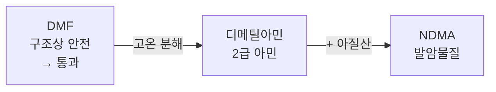

# 실현 가능성 테스트 결과

조사 보고서 3절 상세. 2026-09-27 실행, Windows 11, AiZynthFinder 4.4.1

---

| # | 항목 | 결과 |
|---|---|---|
| 1 | 부산물 수집 | 가능 |
| 2 | 위험 물질 선별 | 가능 |
| 3 | 과거 사고 검출 | 가능. 미검출 항목도 확인 |
| 4 | AiZynthFinder 연동 | 가능 |
| 5 | 잔존 경로 검사 | 완료. 트레이드오프 확인 |

미착수 항목은 맨 아래.

---

## 1. 부산물 수집

| | |
|---|---|
| 필요한 이유 | AiZynthFinder는 부산물 미출력 |
| 사용 | ASKCOS (MIT, 무료) |
| 사양 문제 | 로컬 설치는 메모리 64GB 필요. 공개 서버 이용으로 설치 불필요 |
| 입력 | 에탄올 + 염화아세틸 → 에틸아세테이트 |

| 수집된 물질 | 유형 | 점수 |
|---|---|---|
| CCOC(C)=O | 주생성물 | 1.000 |
| CCOC(=O)CC(C)=O | 과반응 | 0.892 |
| CC(=O)O | 과반응 | 0.373 |
| CC=O | 과반응 | 0.122 |
| O=C(Cl)CCC(=O)Cl | 이량화 | 0.000 |

---

## 2. 위험 물질 선별

위 5개를 두 방법으로 검사.

| 물질 | ICH M7 목록 | 구조 검사 |
|---|---|---|
| CCOC(C)=O | | |
| CC(=O)O | | |
| CCOC(=O)CC(C)=O | | |
| **CC=O** | **아세트알데히드, 하루 2000 µg** | 알데히드 |
| O=C(Cl)CCC(=O)Cl | | |

5개 중 1개 검출. 허용량 동시 산출.

---

## 3. 과거 사고 검출

발사르탄 사고 당시 공정 물질 입력 (EMA 조사보고서 기준).

| 물질 | 결과 |
|---|---|
| 디메틸아민 (DMF 분해산물) | 2급 아민으로 검출 |
| DMF (용매) | **미검출** |
| 아질산나트륨 | 니트로화제로 검출 |
| 아질산 | 니트로화제로 검출 |

2급 아민 + 니트로화제 동시 존재로 니트로사민 위험 판정. 니트로사민은 ICH M7의 특별 위험군이라 하루 1.5 µg 기준으로 불충분, 물질별 개별 한도 필요.

### 미검출 항목



현재 구조만 판정. 이후 변화는 미반영.

---

## 4. AiZynthFinder 연동

### 4-1. 설정 파일로 등록

```yaml
filter:
  genotox:
    type: genotox_plugin.GenotoxFilter
scorer:
  genotox_plugin.GenotoxScorer:
```

| 불러와진 것 | 출처 |
|---|---|
| `uspto` (filter) | 원래 있던 것 |
| **`genotox` (filter)** | **우리가 만든 것** |
| `state score` 외 3개 (scorer) | 원래 있던 것 |
| **`genotox` (scorer)** | **우리가 만든 것** |

AiZynthFinder 원본 파일 무수정.

> 한글 폴더 주의. AiZynthFinder가 설정 파일을 읽을 때 윈도우 기본 인코딩(cp949) 사용. UTF-8 저장 시 한글 경로에서 오류. cp949로 저장하거나 영문 폴더 사용.

### 4-2. 위험 판정

| 물질 | 위험도 | 근거 |
|---|---|---|
| 에탄올 | 0.00 | |
| 아세트알데히드 | 1.00 | ICH M7 목록 |
| Epichlorohydrin | 1.00 | ICH M7 목록 |
| 히드라진 | 1.00 | ICH M7 목록 |
| **NDMA** | 1.00 | **목록에 없음. 구조 검사로 검출** |
| 벤젠 | 0.00 | |
| p-톨루이딘 | 0.50 | 목록에 없으나 위험 구조 존재 |

| 위험도 | 처리 |
|---|---|
| 1.0 | 경로 삭제 |
| 0.5 | 감점만, 경로 유지 |
| 0 | 통과 |

목록과 구조 검사가 각각 다른 것을 검출.

| 물질 | 목록 대조 | 구조 검사 |
|---|---|---|
| 아세트알데히드 | 검출 (허용량도) | 검출 |
| NDMA | **미검출** | 검출 |
| p-톨루이딘 | 미검출 | 검출 |

> NDMA 미검출은 코드에 등록한 15종 시험용 목록 기준. NDMA 자체는 유럽 규제기관 목록에 허용량과 함께 등재. 목록은 등록분만 검출하므로 구조 검사 병행 필요.

### 4-3. 경로 내 위치 반영

경로 뒤쪽 물질은 이후 공정에서 제거될 기회 있음. 마지막 단계는 기회 없음.

Epichlorohydrin 하나를 위치만 변경해 점수 비교.

| 위치 | 점수 |
|---|---|
| 마지막 단계 | 0.000 (최악) |
| 한 단계 앞 | 0.000 |
| 두 단계 앞 | 0.333 |
| 세 단계 앞 | 0.500 |
| 다섯 단계 앞 | 0.667 |

`filter`는 반응 한 단계만 보므로 구분 불가. `scorer`만 가능.

### 4-4. 실제 경로 탐색

| | |
|---|---|
| 대상 | 프로프라놀롤 (고혈압약) |
| 선택 이유 | 공장에서 실제로 Epichlorohydrin 사용. ICH M7 목록 물질, 하루 3 µg 허용 |

| | 경로 | 차단된 반응 |
|---|---|---|
| `filter` 끔 | 8개 | |
| `filter` 켬 | 5개 | 58건 |

| 차단 사유 시약 | 하루 허용량 | 비고 |
|---|---|---|
| Epichlorohydrin | 3 µg | 예상함 |
| Glycidol | 4 µg | 예상 못 함. Epichlorohydrin이 물과 반응하면 생성 |

경로 전부 소멸은 아님. 8개 중 3개만 제외.

---

## 5. 잔존 경로 검사

남은 5개에 목록 밖 위험 물질 존재 여부를 전수 검사.

| | `filter` 끔 | `filter` 켬 |
|---|---|---|
| 경로 | 8개 | 5개 |
| 위험 물질 | 9종 | 6종 |
| 경고 없는 경로 | 1개 | 1개 |

**제외된 물질**

| 물질 | 근거 |
|---|---|
| Epichlorohydrin | ICH M7 목록, 하루 3 µg |
| 클로로아세트알데히드 | 알킬 할라이드 + 알데히드 |
| 염화알릴 | 알킬 할라이드 |

**잔존 물질** (전부 구조 검사에만 해당. ICH M7 목록에는 없음)

| 물질 | 근거 |
|---|---|
| CC(C)NCC1CO1 | 에폭사이드 |
| OC(CCl)CCl | 알킬 할라이드 |
| OC(CBr)CBr | 알킬 할라이드 |
| CC(C)NCC(O)CCl | 알킬 할라이드 |
| OC(CCl)COc1cccc2ccccc12 | 알킬 할라이드 |
| OC(CBr)COc1cccc2ccccc12 | 알킬 할라이드 |

설계대로. `filter`는 위험도 1.0만 차단, 0.5는 `scorer`가 감점.

규칙에도 공백 존재. 알킬 할라이드 규칙은 1급만 검출, 2급 미검출. 이번 경로는 전부 1급이라 영향 없음.

| 강도 | 남는 경로 | 문제 |
|---|---|---|
| 지금 (목록만 차단) | 5개 | 4개에 경고 잔존 |
| 더 세게 (구조 검사도) | 1개일 수 있음 | 경고 없는 경로는 하나뿐 |

본문 회의 안건 ④.

---

## 미착수

| 항목 | 상태 |
|---|---|
| Toxtree 연동 (규칙 판정) | 명령어 실행 가능까지 확인 |
| ADMET-AI 연동 (데이터 판정) | 설치 가능까지 확인 |
| ASKCOS 조건 추천 | 공개 서버 호출 실패 |
| 분해 경로 규칙 | 미착수 (3번 DMF 문제) |

본문 2.2의 "예측기 두 개 병행"은 구현 전. 현재 테스트는 ICH M7 목록 대조와 구조 검사로 진행.

---

## 코드

`C:\Users\hahab\학술제\test\`

| 파일 | 내용 |
|---|---|
| `test1_askcos_byproduct.py` | 부산물 수집 |
| `test2_genotox_screen.py` | 위험 물질 판정 |
| `test3_valsartan_case.py` | 발사르탄 사고 검증 |
| `test4_aizynth_plugin.py` | AiZynthFinder 연동, 경로 탐색 |
| `test5_inspect_routes.py` | 잔존 경로 전수 검사 |
| `test6_yaml_config.py` | 설정 파일 등록 확인 |
| `genotox_plugin.py` | 판정 규칙 본체 |

| | |
|---|---|
| 실행 | `conda activate aizynth-env` 후 `python test4_aizynth_plugin.py` |
| 1~3번 | AiZynthFinder 없이 실행 가능 |
| 4~6번 | 모델 754MB 필요. `download_public_data` 로 수집 |

### 경로 차단부

```python
class GenotoxFilter(FilterStrategy):
    def apply(self, reaction):
        for mol in reaction.reactants[reaction.index]:
            ich = find_ich_m7(mol.rd_mol)
            if ich:
                raise RejectionException(
                    f"{reaction} 차단: ICH M7 지정 위험 물질 {ich[0]} 사용"
                )
```

### 위치별 감점부

```python
def _penalty(self, rd_mol, depth):
    risk = risk_of(rd_mol)
    if risk <= 0:
        return 1.0
    weight = self.late_penalty / (depth + 1)
    return max(0.0, 1.0 - risk * min(weight, 1.0))
```
