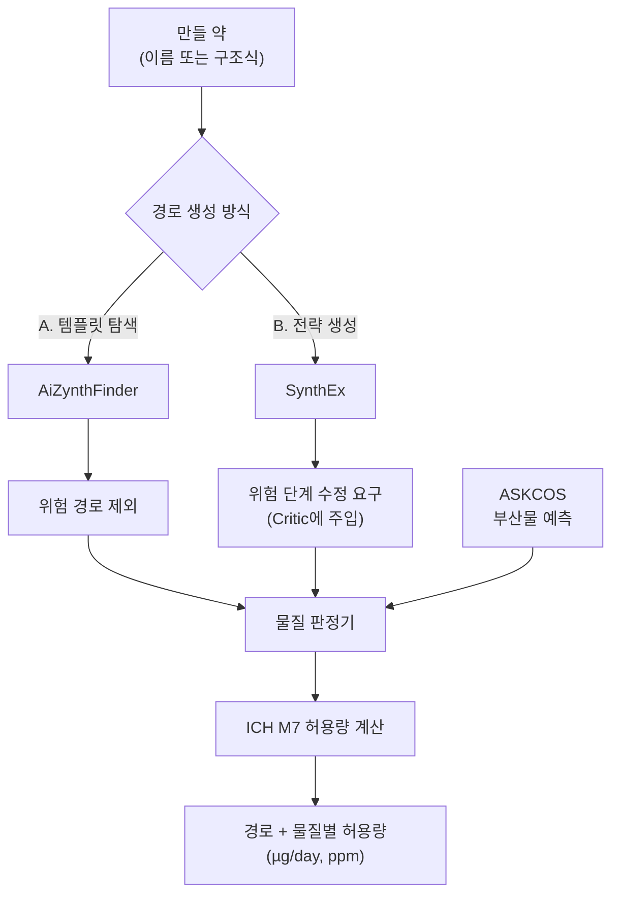

# 학술제 최종 설계안

## 문서 읽는 순서

- [소프트웨어 설명.docx](소프트웨어%20설명.docx): **소프트웨어 설명 → 작동 과정 → 결과물** 순서의 사용자 설명서. 연구 환경과 공개 경량판의 기능을 구분한다.
- [디버깅.docx](디버깅.docx): 증상·원인·조치·검증·남은 한계를 누적한다. 원본 기록은 `evaluation/results/debugging_history.json`이며, `evaluation/scripts/reports/build_debugging_docx.py`는 기록을 읽어 Word만 재생성한다. 새 오류는 기존 항목을 지우지 않고 추가한다.
- 기존 진행현황 Word는 실험·근거·후속 연구 보고서로 유지한다. 이 설계안과 논의보고서는 설계 결정·과거 기록을 보존한다.

## 현재 검증 상태 — 2026-11-02 재개 후

- **현재 회귀:** 인수 후 전체 단위·AppTest **402개 통과·93.432초**([영수증](evaluation/verification/handoff_regression.json), **2026-11-02 16:45:10 UTC+09:00**). 실행 중 투입량 안내·테스트가 변경되어 변경 종료 후 해당 화면 **17개·5.862초**를 별도로 확인했다. 단일 고정 스냅샷의 전체 검증은 아니며 실행 수는 합산하지 않는다. 경고는 로그에 보존했다. 이전 Gen4 **402개·50.790초**는 [별도 기록](evaluation/verification/gen4_regression.json)이다.
- **탭 복귀 오류 수정:** 저장 경로 → `물질 검사` → `처음 화면`에서 보고서 문맥은 남고 경로 선택기 키만 삭제됐다. `index=None`이 빈 선택을 반환해 `TypeError`가 났다(`artifact://899`). 명시적 index를 제거해 첫 경로로 복구했다. 회귀는 같은 왕복을 두 번 확인한다. 실제 브라우저도 `example-known-concern`과 예외 **0건**을 기록했다([복구 근거](evaluation/verification/gen4_tab_recovery.json)).
- **Gen4 코드 변경분 검토:** 33번 아키텍처 **CLEAR / APPROVE**, 34번 정리 **PASS**, 35번 QA **PASS**다. 검토 대상 해시는 `sha256:0d95c192982249c7ee49bb8a3d2ddbbca52c8756bcc5305c27c0fa9d116b4afb`다. 이 승인은 코드 변경분에 한정한다.
- **Word 갱신:** 현재 회귀를 반영해 재생성한 17쪽의 전체 모아보기와 2·16쪽 개별 이미지를 확인했다([현재 렌더링 영수증](evaluation/verification/handoff_report_receipt.json)). 관찰 범위에서 빈 쪽·표 잘림·겹침은 없었다. 보고서의 검토 대기 문장은 빌드 시점 상태이며 빌드 후 확인은 이 영수증을 따른다.
- **전체 완료는 미선언:** 이번 문구·문서 변경은 Gen4 승인 이후다. 기존 G005–G007의 공식 최종 검토·종료는 별도로 남아 있다. 이전 영수증을 새 변경분 승인으로 쓰지 않는다.

승인된 로컬 Git 기준점 **`bb53a52`**는 과거 구현 diff를 복원한 것이 아니다. 위 회귀·Word 검토 당시에는 배포하지 않았다. 이후 사용자의 업로드 요청에 따라 개인 저장소에 경량판을 공개했다.

**공유 상태:** [Yebin-Choi/synthesis-route-review](https://github.com/Yebin-Choi/synthesis-route-review)에 소스·예시·설치 안내 18개 파일을 공개했다. 다운로드본의 해시 일치, 별도 환경에서 배포 범위 테스트 115개, 실제 화면 실행을 확인했다([근거](evaluation/verification/github_download_verification.json)). Python 3.11이 필요하며 `start.bat`은 기존 `.venv` 분기를 검증했다. 모델·조건 원자료·실험 비교 데이터·내부 문서·기존 Git 이력은 제외했다. 무료 웹 호스팅은 미완료이며 Windows 외 실행은 검증하지 않았다. 로컬 검토 영수증과 새 설명·디버깅 Word는 공개 저장소에 포함하지 않았다.

### G004 오류 수정·단순화 기록 — 2026-11-02, 후속 수정 전

- `None`, 숫자 및 같은 내용의 문자열에서 생기던 무효 평가 식별자 중복을 제거했다. 정확한 출력 문자열별로 미평가를 합치고 `input_types`에 원래 입력 유형을 보존한다. 문자열로 표현된다는 이유로 비문자열 입력을 유효 구조로 바꾸지 않는다.
- 조건·부산물 메타데이터의 NaN·Infinity·순환 참조·JSON으로 표현할 수 없는 값을 엔진 검증 단계에서 거부한다. 보고서 식별 해시와 동일하게 키 정렬 직렬화도 검사하여 혼합 키 오류를 조기에 차단한다. 입력 근거를 삭제하거나 임의 변환하지 않는다.
- 문자열 배열 검증에서 사용하지 않던 결과 리스트 생성을 없앴다. 원래 SMILES와 판정·누락 사유를 보존하며 새 추상화나 의존성은 추가하지 않았다.

## 구현 검증에 따른 수정 사항 — 2026-10-29 작성 · 2026-11-02 근거 갱신

**재개 기준:** 사용자가 2026-11-02 중단 후 작업을 재개했다. 아래 추가 경로 실험은 저장된 2026-10-30 결과를 반영한 것이며 재개일에 새로 실행했다고 쓰지 않는다. 중단·승인 대기를 야간 연속 가동이나 실험 실행시간으로 계산하지 않는다. 이전 실행·설계 기록은 아래에 보존한다.

### 확정한 제품 범위와 출시 기준

**제품 형태:** 경로·조건·물질 기록을 먼저 보존하고 물질별 평가 결과를 연결하는 **설명 가능한 사후 선별 연구 도구**. 무독성 경로 보장, 자동 규제 등급, 투입량만으로 독성 부산물 생성량을 예측하는 기능은 최종 버전 주장에 포함하지 않는다.

- **실제 추론 모듈 구현:** `app/admet_service.py`·`admet_worker.py`로 별도 환경의 ADMET-AI Ames를 실행하고, 구조 별칭 중복 제거·모델 버전·가중치 해시·점수·고정 임계값·미평가 사유를 보존한다. 저장 CSV 조회와 새 추론을 구분하며, 실제 저장 경로 15구조의 새 추론을 완료했다.
- **연구용 판정 구현:** `app/ames_route_review.py`의 동일 비목표 물질 규칙 우려 AND ADMET 양성 사후 검토를 구현했다. 명시 제외 목록은 별도로 유지하고 OR-only·실패·미실행·조건 및 부산물 누락 사유를 숨기지 않는다. 이 정책은 ICH M7 판정을 대체하지 않는다.
- **기록·화면 범위:** 원래 경로 보고서와 물질별 모델 근거·공동 검토를 연결하는 스냅샷 기반이다. 기존 UI 관찰 범위는 아래 날짜·산출물로 구분한다. 실패·재시도·부분 출력의 기존 근거는 AppTest이며 실제 서버 장애 주입은 아니다. 실시간 생성 이벤트 로깅은 미구현이다.
- **정량 기능:** 단일 반응 수동 투입량 계산과 코어의 명시 양론·수율 계산을 제공하되, 실제 경로의 누락값을 채워 넣지 않는다. 계산된 투입량을 부산물 발생량으로 바꾸지 않는다.
- **VEGA 실제 실행:** SarPy-IRFMN 1.0.8의 기존 3종 스모크에 이어 17개 유효 구조·무효 대조 1건의 파일럿 출력을 확보했다. 기존 경로 15구조를 모두 포함한다. 원시 예측·참조값·보수 정책을 분리하며 독립 정확도 검증이나 임의 다수결로 쓰지 않는다.
- **SynthEx 위치:** 주 생성기로 유지한다. 경로 파일 가져오기와 실제 LLM 생성 성공은 다르다. `product>>precursors`의 전구체는 상류에서 분리한 연결 구조 조각이다. 전하를 없애거나 조각을 재조합하지 않으며 완전한 염 생성물과 구분한다. 상류에 없는 염 구성 조각의 묶음 정보는 복원하지 않는다. 실제 상류 렌더링→가져오기 테스트로 이 경계를 확인했다. 화학·어댑터 실행 로직 변경이나 새 합성 실험은 아니다. AiZynthFinder 결과를 SynthEx 성과로 쓰지 않는다.

**검증 경계:** 소프트웨어 테스트·화면 관찰·Word 렌더링은 화학적 성능이나 안전성을 입증하지 않는다. 빌더는 필수 [검증 명세](evaluation/results/software_verification.json)를 읽으며 명세 누락·형식 오류 시 생성에 실패한다. 선택적 근거의 누락·미완료는 확인 대기로 남긴다. 이번 문서 갱신에서 모델을 다시 실행하지 않았다.

**이전 회귀 — 2026-11-02:** 최종 CSS 보정 전 전체 **401개·123.419초**(`artifact://856`)와 CSS 보정 후 UI 집중 **32개·69.910초**(`artifact://863`)는 별도 실행이다([범위 기록](evaluation/verification/gen2_parent_regression_receipt.json)). 32개 실행에는 중복 위젯 초기화 경고가 남아 있었다. 두 수를 합산하지 않는다. G004의 **397개·132.492초**(`artifact://756`)와 기준선 재실행 **397개·132.642초**([영수증](evaluation/verification/baseline_unittest.json))도 구분한다. 더 이전의 **384개·189.331초**(`artifact://583`), **376개·156.080초**(`artifact://574`), **338개·333개 통과**, 추론 어댑터 **37개**·공동 검토 **29개**는 당시 범위로 보존한다. 개별 실행일·소스는 원문을 따른다.

**사용 흐름:** 목표 선택·경로 준비 → 경로·단계 선택 → 구조와 조건·부산물 누락 확인 → 명시적으로 Ames 검사 실행 → 정책별 이유 비교 → 원본·평가 근거 JSON 내보내기. `needs_review`는 경보·불일치 등의 추가 검토, `insufficient_data`는 조건·구조·모델 근거 등의 부족, `excluded`는 선택한 연구 정책에 따른 제외다. 대표 상태가 제외·검토여도 다른 누락 사유는 남는다. `candidate`도 평가 범위 내 후보일 뿐 어느 상태도 안전성·실제 생성·ICH M7 판정이 아니다.

**이어 쓰는 실제 모델·UI 근거 — 2026-11-02, Gen4 이전:** UUID **`f8c3a397-4b77-435e-b935-5b868d57bc99`**에서 **15구조 모두 성공**, 실제 JSON **6경로·15평가 행**을 확인했다. 정책 켜기·끄기 전후 UUID·시각·모델 해시·보고서 해시는 같았다. 가상 예제를 불러오면 `example-known-concern`으로 바뀌고 `aizynth-1` 잔상·이전 성공 표를 숨기며 Ames는 미실행으로 돌아갔다. **1440px 데스크톱·390×844 모바일**에서 가로 넘침·탭 가림 해소와 키보드 탐색을 확인했다. 상단 여유 **4rem**, 설명 **16px·#475569·불투명도 1**, 주요 동작 초점 **3px 파란 윤곽선**의 관찰도 이 실행 범위다. 목표물 제외·기재 물질만 검사·미상 부산물 미평가 안내는 유지했다. 변경되지 않은 계약의 기존 근거이며 Gen4 모델 재실행은 아니다. 실패·재시도·부분 출력은 AppTest 범위이고 실제 서버 장애 주입은 하지 않았다. 근거: [실행·관찰 기록](evaluation/verification/refined_browser_automation.json). 재시작 전 캐시된 import의 관찰과 구분한다.

**이전 Word 관찰 — 2026-11-02 15:08:03 UTC+09:00 기록:** [17쪽 렌더링 영수증](evaluation/verification/refined_report_receipt.json)은 Gen4와 이번 문서 갱신 전 빌드다. 전쪽 모아보기는 마지막 페이지 나눔 수정 전에 확인했다. 수정 후에는 1쪽만 다시 관찰했다. 나머지 최종 쪽은 렌더링했지만 개별 재관찰하지 않았다. 이번 갱신본은 새 빌드·관찰·영수증이 필요하다.

**이전 Word 관찰 — 2026-11-02 11:02:48 UTC+09:00 기록:** [렌더링 기록](evaluation/results/report_render_verification.json)의 **이전 빌드**는 네이티브 Word **16쪽**, 전쪽 모아보기와 **2·16쪽 원본 크기**를 확인했다. 그 범위에서 표 잘림·빈 쪽·텍스트 겹침은 관찰되지 않았다. 기록 해시는 그 빌드만 가리키며 이번 수정 후 새 생성본은 별도 생성·관찰·영수증 갱신 대상이다.

**이전 브라우저 관찰 — 2026-11-02, 후속 수정 전:** ADMET 15구조 모두 성공, 보수 정책으로 전환해도 평가 UUID **1682ed75-3303-4368-a90a-75487a702ff7** 유지, 실제 JSON에 **6경로·15평가 행** 보존을 확인했다. 보고서를 바꾸면 이전 점수·평가 식별자를 숨기고 미실행 상태로 돌아갔다. 이는 이후 발견한 선택 경로 전환 잔상과 다른 시나리오이며 그 결함의 부재·수정 완료를 입증하지 않는다. 근거: [실제 내보내기](evaluation/results/current_ui_export.json) · [정책 전환의 재사용](evaluation/results/current_ui_policy_reuse.json) · [입력 변경 시 무효화](evaluation/results/current_ui_invalidation.json). 저장 완료 시각은 **2026-11-02 10:47:01 UTC+09:00**이며 인증된 실행 시각 증빙과 구분한다.

### 추가 두 목표의 저장 경로 실험 — 2026-10-30, 구조 규칙 전용

AiZynthFinder **4.4.1**, 목표별 탐색 **30초·30회 한도**, 작업자 제한 **300초**의 실제 저장 결과다. 기본·보수 정책은 각 목표의 **같은 경로 집합**을 사후 분류했다.

| 목표 | 저장 경로 | 작업자 내부 시간 | 기본 정책 | 보수 정책 |
|---|---:|---:|---|---|
| 아세트아미노펜 | 15 | 24.4479초 | 제외 0·검토 8·정보 부족 7·후보 0 | 제외 8·검토 0·정보 부족 7·후보 0 |
| 이부프로펜 | 5 | 35.8320초 | 제외 0·검토 5·정보 부족 0·후보 0 | 제외 5·검토 0·정보 부족 0·후보 0 |

- 아세트아미노펜: [실행 결과](evaluation/bounded_route_acetaminophen/result.json) · [정책 결과](evaluation/bounded_route_acetaminophen/policies.json) · [사전 명세](evaluation/bounded_route_acetaminophen/preregistration.json). 저장 완료 시각은 **2026-10-30 12:52:16 UTC+09:00**다.
- 이부프로펜: [실행 결과](evaluation/bounded_route_ibuprofen/result.json) · [정책 결과](evaluation/bounded_route_ibuprofen/policies.json) · [사전 명세](evaluation/bounded_route_ibuprofen/preregistration.json). 저장 완료 시각은 **2026-10-30 12:53:04 UTC+09:00**다. 이 시각은 파일의 UTC 기록을 변환한 것이지 인증된 실행 시각 증빙이 아니다.

작업자 내부 시간은 모델 로딩·탐색·규칙 분석·선별 저장을 포함한다. 탐색 한도 30초와 같지 않으며, 이전 선별 전용 ms나 별도의 ADMET 실행시간과 직접 비교하지 않는다. 시드를 고정하지 않아 같은 경로 재현을 보장하지 않는다. 입력 구조·실행기·모델·재고 해시는 사전 명세에 보존했다.

**이 20경로에는 새 ADMET 추론을 하지 않았다.** 아래의 기존 6경로·15구조 ADMET 실험과 별개다. SynthEx 생성, 화학적으로 검증된 합성법, 탐색 중 가지치기나 탐색 속도 향상 결과가 아니다. 보수 정책의 제외는 독성·실제 생성의 입증이 아니다. 조건·부산물 생성·수율·양론은 미상이고 이부프로펜 입력의 입체화학도 미지정이다. 상태상 ‘정보 부족 0’이어도 제외·검토 경로의 누락 사유가 없어졌다는 뜻은 아니다.

### 파라세타몰 부산물 문헌 — 자동 규칙은 보류

[2018년 논문 초록·하이라이트](https://www.sciencedirect.com/science/article/pii/S0255270118302393)(DOI **10.1016/j.cep.2018.07.006**)은 저자 공정의 물 존재 조건에서 파라세타몰 form I·순도 **99%**, 물 부재 조건에서 **4-acetoxyacetanilide**가 주 생성물이라고 보고한다. 확인 범위는 초록·하이라이트이며 상세 실험법·수치 표는 확보하지 못했다. 구조는 [PubChem CID 17499](https://pubchem.ncbi.nlm.nih.gov/compound/17499)로 확인한 문헌 후보일 뿐, 로컬 경로에서 관측한 부산물·양론적 공동 생성물이 아니다.

**99%는 제품 순도이지 분리수율이나 특정 부산물 1%가 아니다.** 물 존재가 부산물 0의 음성 대조를 뜻하지도 않는다. 물의 양·온도·당량·농도·시간·전체 제조법·개별 부산물 정량/검출한계가 없고 로컬 경로에도 대응 관측 조건이 없다. 완전한 조건 일치 제조법과 음성 대조를 확보하기 전에는 자동 생성·정량 규칙, 보편적 물 임계값, 안전 잔류량을 만들지 않는다. 조건 누락은 음성이 아니라 미평가다. 근거·미확보 항목: [문헌 근거 기록](evaluation/results/paracetamol_byproduct_evidence.json).

### Ames 상보성 조사와 VEGA 확대 파일럿 상태

[ICH M7(R2) §6](https://database.ich.org/sites/default/files/ICH_M7%28R2%29_Guideline_Step4_2023_0216_0.pdf)은 기존 실험·문헌 자료 확인과 **전문가 규칙 기반·통계 기반 방법론의 상보성**을 요구한다. 두 브랜드를 쓰거나 ICH M7 규칙과 ADMET이 일치한다고 충족되는 기준이 아니다. 모델 검증·적용 범위·불일치 해석·전문가 검토가 필요하다.

- **SarPy-IRFMN:** [SARpy 방법 논문](https://gini.faculty.polimi.it/papers/SARQSAR13.pdf)(DOI 10.1080/1062936X.2013.773376)의 초록·서론은 실험 자료에서 구조 조각·규칙을 자동 추출한다고 설명한다. 경보 형태라고 자동으로 전문가 규칙 기반의 독립 대응축이 되지 않는다. 이 문헌 분류는 설치된 1.0.8 바이너리의 독립 검증도 아니다.
- **Derek Nexus·Sarah Nexus:** [Lhasa 현재 공식 설명](https://www.lhasalimited.org/solutions/in-silico-mutagenicity-assessment/)과 [공식 도움말](https://productdocumentation.lhasalimited.org/Nexus/ICH_M7/Welcome_ICH_M7.htm)에서 전문가 규칙 기반·통계 기반의 상보적 사례를 조사했다. 도움말은 2017년판이며 **설치·실행하지 않았다**. 구매·계정·이용권·무료 접근이나 독립 성능을 가정하지 않는다.
- **로컬 도구의 한계:** ICH M7 규칙은 탐색용 경보, ADMET은 학습 중첩·적용 범위 미확인, Toxtree 예외 출력은 보류다. 다른 종말점·대사·유사체 정보는 보완 자료이지 Ames 두 방법의 자동 대체물이 아니다. 상세 출처: [상보적 방법 조사 기록](evaluation/results/complementary_ames_methods.json).

**VEGA 경로 물질 파일럿 실제 실행 종료:** [입력 명세](evaluation/results/vega_route_pilot_manifest.json)와 [실제 출력](evaluation/results/vega_route_pilot_results.json)을 확보했다(실행 영수증 `artifact://568`). 총 **18기록=유효 구조 17종+무효 대조 1건**이며 기존 경로의 ADMET 15구조를 모두 포함한다. Java 출력·ID/구조 정체 확인 **17건**, 참조 실험값 보유 **7건**, 별도 보수 정책 허용 **5건**, 오류 포함 기록 **0건**이다. 무효 대조는 Java에 보내지 않았다. 대조 역할은 경로 물질과 중복될 수 있어 별도로 더하지 않는다.

| 18기록 전체 기준 | 양성 | 음성 | 보류 |
|---|---:|---:|---:|
| 원시 예측의 연구용 매핑 | 7 | 2 | 9 |
| 별도 보수 정책 | 5 | 0 | 13 |

보류 수에는 무효 대조 1건이 포함된다. `GOOD reliability`·유한 ADI·`OUTPUT_OK`와 정상 원시 이진 판정을 요구하는 것은 **프로젝트의 보수 규칙이지 보편적인 ADI 임계값이 아니다.** 새 수치 절단값을 만들지 않았다. `CC(C)N`과 `CCO`는 참조값이 NON-Mutagenic이어도 원시 예측은 **−1·Possible NON-Mutagenic**이므로 보류를 유지한다. 참조값 우선 기본 assessment를 원시 모델 예측으로 바꾸어 쓰지 않는다. 이 파일럿은 실행·정체 확인·보류 처리의 근거이며 **정확도·안전성·ICH M7 준수 검증은 아니다.** 학습·참조 중첩은 미해결이고 새 경로·부산물·ADMET 추론도 하지 않았다. 저장 종료 시각은 **2026-11-02 10:49:56 UTC+09:00**다. Word 빌더는 이 실제 집계를 읽되 향후 파일 부재·미완료·연결 불일치에는 미확인·대기를 유지한다.

독립 검토에서 체크포인트 저장 중 중단 시의 일관성 결함을 발견해 이후 **임시 파일·fsync·원자적 교체**로 수정하고 장애 주입 테스트 **8개**를 추가했다. 위 실제 파일럿은 **수정 전 소스의 실행 결과**이며 입력 명세·해시는 변경하지 않고 보존했다. 수정된 실행기로 파일럿을 다시 돌렸다고 주장하지 않는다.

### 저장된 실제 경로 추론·교차 도구 실험 — 2026-11-02 갱신본, 후속 수정 전

`evaluation/results/live_route_ames_experiment.json`의 같은 AiZynthFinder 6경로에 기재된 비목표 15구조를 ADMET-AI 2.0.1·기준선 0.5로 새 추론했으며 모두 성공했다. **24.6434753초는 작업자 시작·가중치 해시·모델 추론을 포함한 시간**이지 경로 생성 시간이 아니다. 목표물 자체는 불순물 평가에서 제외된다. 검사 범위는 기재된 물질뿐이며 구조 미상의 부산물·미기재 시약 등 모든 가능한 생성물을 포괄하지 않는다.

| 동일 경로 집합의 정책 | 제외 | 검토 | 정보 부족 | 후보 |
|---|---:|---:|---:|---:|
| 구조 규칙 전용 기본 | 0 | 5 | 1 | 0 |
| 구조 규칙 전용 보수 | 5 | 0 | 1 | 0 |
| 동일 물질 규칙 AND 실제 ADMET | 5 | 0 | 1 | 0 |

중복 제거 물질별 규칙/ML 조합은 음성/음성 8개·양성/양성 5개·음성/양성 1개·양성/음성 1개다. 두 OR-only 물질은 미해결 우려이며, 경로의 제외 상태가 우선해도 그 근거와 조건·부산물 누락 사유를 모두 보존한다. 경로 수 감소를 독성 제거율이나 안전성으로 해석하지 않는다. 이전 30회 사후 선별 중앙시간 16.249450/17.570700ms는 독성 추론·생성·네트워크를 제외한 별도 측정이다.

`evaluation/results/vega_ames_smoke.json`·`ames_cross_tool_smoke.json`의 실제 결과:

| 물질 | ADMET-AI Ames 점수 | VEGA SarPy-IRFMN 1.0.8 원시 예측 |
|---|---:|---|
| Ethanol | 0.11980575 | Possible NON-Mutagenic |
| Epichlorohydrin | 0.98295325 | Mutagenic |
| NDMA | 0.93948793 | Mutagenic |

세 VEGA 실행 모두 `OUTPUT_OK`, ADI 1·GOOD reliability이며 실험/참조값이 있다. 기본 assessment가 실험값을 우선할 수 있어 원시 모델 예측과 분리한다. Possible NON을 단순 음성으로 바꾸지 않으며 독립 성능·규제 적합성을 주장하지 않는다. 별도 스모크에서 잘못된 `CC(`는 점수 없이 abstain, 원자 매핑 에탄올 별칭은 CCO와 중복 제거했다. ADMET의 적용 범위·학습 중첩은 여전히 미확인이다.

**남은 검증:** 갱신한 명세·보고서의 근거 일치를 확인하고 새 Word를 생성·관찰한다. 그 스냅샷의 최종 종합 검토가 끝나기 전에는 전체 완료로 쓰지 않는다.

**후속 연구:** 독립 Ames 자료의 학습·참조 중첩 감사, Toxtree 20종 단건 예외 격리 후 200종 재평가, 문헌 조건·음성 대조·조건 누락 대조를 갖춘 제한된 부산물 사례다. 팀 원본 KB·목표 적용성·실제 양론·분리수율·부산물 정체·정량 자료가 없으면 투입량–독성 부산물 임계값을 만들지 않는다. SynthEx 실제 생성·생성 이벤트 기록·탐색 중 개입은 자격증명과 어댑터 검증 이후의 별도 범위다.

### 합성 투입량 수치화의 가능성 점검

**252개 기준선에서 확인한 정량 UI:** 앱의 `투입량 계산` 탭에서 명시적 입력 기반 단일 반응 역산과 저장 경로의 정보 부족 감사를 제공한다. 다단계·분기 지원은 계산 코어에 있고, UI는 단일 반응으로 범위를 표시한다. 당시 전체 단위·AppTest **252개 통과**, 브라우저 탭 로딩 오류 없음 확인. 이전판 Word 보고서는 실제 Word **10쪽** 렌더링을 확인했으며, 최신 추론 결과 반영판은 별도 생성·렌더링 확인 대상이다.

**계산기 구현·집중 검증 완료:** `app/material_balance.py`와 47개 테스트로 목표 질량·단계별 수율·양론 역산, 분기 및 공통 전구체 합산, 당량의 기준 물질, 반응식 계수 배율 불변성, 구조/단위/누락/순환 오류 처리를 확인했다. 시약 당량에는 참조 물질이 명시되어야 하며 제한 반응물을 임의로 추정하지 않는다. 내부 중간체와 외부 투입량은 별도로 집계하여 이중 합산하지 않는다.

가정 예시: 아세트산에틸 100mg × 10,000개 = 1kg 목표, 아세트산:에탄올 1:1, 수율 80%를 **가정**하면 각 14.187456mol, 아세트산 851.985g·에탄올 653.602g이 계산된다. 실제 공정·수율·부산물 생성량을 검증한 값은 아니다. 저장된 실제 AiZynthFinder 6경로는 모두 수율·반응 계수 등 부족으로 `insufficient_data`이며 투입량을 만들어 내지 않았다. 입력/출력: `evaluation/results/material_balance_verification.json`.

사용자가 말한 수치는 **합성할 때의 투입량·당량·농도**다. 복용량/최종 잔류 노출 계산을 주 기능으로 바꾸지 않는다. 단위 제품의 원료의약품 질량 × 생산 개수로 목표 생산량을 정하고, 명시적인 반응 계수·개별 반응 수율로 투입량을 역산하는 물질수지는 구현·검증 대상이다. 역합성 그래프만으로 수율·정제 손실·부산물 생성량을 추정하지 않는다. 원료의약품 형태/분자량 기준을 맞추고, 분기 경로의 공통 전구체 수요는 합산해야 한다.

**실제 데이터 확인 결과:** Suzuki Sheet1 5,760행의 반응물1 당량은 모두 1, mmol은 모두 0.0004, 반응물2 당량은 모두 1, 촉매 당량은 모두 0.0625, 시약 당량은 모두 2.5였다. 리간드 당량은 5,280행에서 0.125이고 480행은 값이 없었다. 즉 이번 자료는 조건 구성물 비교에 쓸 수 있지만, 비결측 투입 비율이 고정돼 있어 **투입량을 늘릴 때 독성 부산물이 어느 지점에서 증가하는지 학습할 자료가 아니다.** 원자료 수율 지표도 UV 면적 %라 분리 수율로 대입하지 않는다.

기록: `evaluation/results/synthesis_quantity_data_audit.json`. 이 한계는 실패가 아니라 필요한 추가 실험 자료를 특정한 결과다. 다음 데이터는 동일 반응·기질에서 투입 당량/농도를 달리하고 부산물 정체·정량값까지 관측한 자료여야 한다. 실제 정량값이 없는 경우 물질수지 계산 결과와 독성/부산물 예측 결과를 합쳐 가짜 임계 농도를 만들지 않는다.

**추가 해결 시도:** [Summit 공개 Reizman Suzuki case 1 원자료](https://github.com/sustainable-processes/summit/blob/master/summit/benchmarks/data/reizman_suzuki_case_1.csv) 96행을 내려받아 해시와 함께 보존했다. 촉매량 0.496–2.515 mol% 변이가 있고, 보고된 촉매 종류·시간·온도가 같은 관측 중 투입량 범위가 0.5 mol% 이상인 묶음 11개를 확인했다. 실제 실험 학습용 CSV이며 에뮬레이터 예측을 실험값으로 사용한 것이 아니다. 단 부산물 구조·생성량 열이 없어 독성 부산물 임계값 산정에는 부족하다. 원논문 DOI 10.1039/C6RE00153J의 접근은 403으로 분석법과 추가 통제 변수를 확인하지 못했다. 수율을 분리 수율로 승격하거나 840조합 KB에 자동 병합하지 않았다. 감사 결과: `evaluation/results/reizman_quantity_audit.json`.

### ICH M7 기준 확인과 Ames 점수 분포 실측

[ICH M7(R2) 원문](https://database.ich.org/sites/default/files/ICH_M7%28R2%29_Guideline_Step4_2023_0216_0.pdf) §3·§6을 확인했다. 핵심 종말점은 세균 복귀돌연변이(Ames)이며, 계산 평가에서는 **전문가 규칙 기반과 통계 기반의 상보적인 두 방법**을 사용하도록 한다. 다른 유전독성 종말점을 추가하는 것은 보완 연구가 될 수 있지만 Ames 예측의 두 방법을 대체하지 않는다. 적합한 모델·적용 범위·전문가 검토 없는 임의의 도구 두 개나 자체 간이 규칙만으로 M7 충족을 주장하지 않는다.

- ADMET-AI Ames는 통계 예측 축으로 연구 비교한다. ICH M7 규칙은 설명 가능한 연구용 경보이지 검증된 규제용 전문가 시스템으로 취급하지 않는다.
- [Toxtree ISS Ames](https://toxtree.sourceforge.net/ames.html)는 결정트리 기반 Ames 경보라는 다른 방법론을 제공한다. 다만 현재 로컬 배치의 내부 예외가 해결되지 않아 그 결과는 여전히 abstain이다.
- [OECD QSAR Toolbox](https://qsartoolbox.org/)는 실험 자료 조회·유사체 read-across·기전 프로파일·대사 정보 보완에 유용하다. 대사산물 예측을 합성 부산물 예측으로 바꾸어 해석하지 않는다.
- VEGA는 단일 방법론 이름이 아니다. 선택한 개별 모델의 종말점·기반 방법·학습 자료·적용 범위를 확인해야 중복 여부를 판단할 수 있다. 도구가 다르다는 이유만으로 독립 증거라고 부르지 않는다.
- AND 양성만 경로 제외하는 규칙은 연구용 운영 정책이다. 한 방법만 양성인 OR-only 사례는 기록만 하고 종결할 것이 아니라 **미해결 우려·검토 대상으로 유지**한다. 이는 M7의 판정 절차를 AND 투표로 대체한 것이 아니다.

실제 저장 점수 7,255개에 대해 실험 음성 3,304개/양성 3,951개의 분포와 0~1 간격 0.01의 101개 임계값 표를 생성했다. 파일: `evaluation/figures/ames_score_histogram.png`, `ames_threshold_sweep.csv`, `ames_threshold_metrics.json`. 0.5 기준 민감도 88.28%, 특이도 81.84%, 거짓음성 463개이며 평가 실패는 0개다. 0.7에서는 거짓음성이 916개로 증가했다. 임계값을 높이면 음성 구분은 개선될 수 있으나 양성 누락이 늘어나는 상충을 보여준다.

분포는 서로 겹친다. 최적 임계값을 자동 선택하거나 앱에 적용하지 않았고, 0.5 기준을 유지했다. TDC 학습 중첩이 해소되지 않았으므로 이는 탐색 분석이지 독립 성능·보정 확률·ICH M7 준수 검증이 아니다. 추가 분석 코드의 경계값·음성/양성 없는 집단·미평가·ID/구조 불일치·출력 검증 테스트 23개 통과.

### 이전 구현·실행 기록 — 2026-10-29 작성본의 단계별 범위

> 아래 재계획·통합·도구 실행 절은 2026-10-29 작성본에 누적된 이전 단계의 기록이다. 개별 실행일·범위는 산출물을 따른다. VEGA 미실행, ADMET 미연결, 67·100·165개 테스트 등의 당시 상태를 최신 결과로 읽지 않는다. 현재 검증 상태는 문서 상단을 우선한다.

상태: **사용자의 후속 설치 요청에 따라 VEGA 전용 환경 설치·의존성 검증 완료. 모델별 실제 예측 검증과 아래 신규 개발은 아직 미완료.** 기존 165개 테스트 통과 구현을 기준선으로 유지한다. 사용자 요청의 `ralph` 이름은 현재 노출된 워크플로에서 찾지 못했으며, 다른 워크플로를 실행한 것으로 대체 표시하지 않는다.

설치 복구 기록: 공식 YAML의 Conda 패키지 131개 설치 후 TensorFlow 단계에서 명령 시간 제한이 발생했다. 잔여 프로세스가 없음을 확인한 뒤 같은 VEGA 환경에 공식 지정 `tensorflow==2.10.0`을 설치했다. `pip check`는 문제 없음, TensorFlow 2.10.0/PyTorch 2.5.1/NumPy 1.26.4/pandas 2.2.3/RDKit 2023.03.3/scikit-learn 1.6.1/XGBoost 2.1.4 import와 TensorFlow·PyTorch CPU 계산을 확인했다. CUDA 경고는 있었으나 CPU 계산은 성공했다. VEGA를 실행하고 `evaluation/vega_repaired_launch.log`에 시작 로그를 보존했다. 바탕 화면의 `VEGA_학술제.lnk`로 실행할 수 있다. 이는 개별 QSAR 예측 성공의 증거는 아니다.

1. **VEGA 설치 진단·복구**
   - 기존 설치·프로세스·환경 등록을 다시 확인해 사용자 작업과 중복되지 않게 한다. 설치 실패 원문을 남기고 기존 환경 삭제나 모델 의존성 임의 변경 없이 원인을 해결한다.
   - 현재 Java 21과 기본 Miniconda는 확인됐으나 `VEGA_global_V3`는 없었다. Python 환경은 일부 모델용이며 Java 모델 전체 실행의 선행 조건은 아니다.
   - Ames 모델을 먼저 선택해 소수 구조의 실제 예측·모델 버전·적용 범위·오류 출력을 확보한다. Python 모델이 필요한 경우 공식 YAML 환경을 생성하고 패키지 import와 해당 모델의 실제 예측까지 확인한다.
   - 완료 기준: 창 열림이나 Python 설치가 아니라 **선택 모델의 재현 가능한 출력**. 필요한 대화형 동의는 사용자에게 명시하며 조용히 약관 동의·설치 삭제를 대행하지 않는다.
2. **ADMET-AI 점수·실험 라벨 분석**
   - 저장된 점수와 라벨을 ID+정규화 구조로 대조하고 양성/음성 분포·ROC/PR·임계값별 민감도/특이도/거짓음성 수를 만든다.
   - 0.5를 기존 비교 기준으로 보존한다. 임계값 선택용 자료와 최종 평가 자료를 분리한다. 이미 ADMET 학습에 쓰였을 가능성이 있는 TDC 자료를 다시 나눠도 독립 외부 검증이 되는 것은 아니다.
   - 완료 기준: 분포 그림과 임계값 표, 데이터 중복·학습 중첩 한계. 독립 자료가 없으면 탐색 결과로만 표기하고 “최적/검증된 임계값”으로 배포하지 않는다.
3. **중간체별 ADMET-AI 검사 연결**
   - 원료·중간체·조건 구성물의 정규화 구조를 중복 제거해 배치 추론하고 모델 버전·점수·임계값·상태를 저장한다. 모델 실패/미실행은 음성이 아니라 미평가다.
   - 기본 정책은 **자체 구조 경보 AND ADMET Ames 양성 → 연구 정책상 제외**, 하나만 양성 → 검토 기록, 둘 다 음성 → 평가 범위 내 경보 미검출이다. 사용자가 명시한 제외 목록은 별도 근거로 유지한다.
   - 완료 기준: 각 조합·실패·미평가·조건 부족을 포함한 진리표 테스트 및 동일 경로 집합의 제외 이유 추적. 실제 Ames 변이원성과 유전독성 전체를 구분한다.
4. **VEGA 최종 교차검토**
   - 통과 후보와 OR-only 검토 경로의 관련 물질을 확인하며, 제외 물질에서도 사전 정의한 표본을 함께 검토해 선택 편향을 기록한다.
   - 출력 파싱 계약·모델 적용 범위를 먼저 검증한다. 자동 배치 인터페이스가 확인되지 않으면 공식 GUI 내보내기 파일로 추적 가능한 검토를 수행한다.
   - 완료 기준: 모델별 결과·적용 범위·불일치·미평가 표시. VEGA를 정답이나 안전 인증으로 사용하지 않는다.
5. **탐색 중 개입과 조건·부산물 통합**
   - 주 생성기는 SynthEx다. 실제 생성 실행과 개입 지점을 확인한 뒤, 위 사후 정책을 기준으로 탐색 중 검사·캐시를 연결한다. AiZynthFinder 실험은 별도 비교 경로로 표기한다.
   - 무필터/사후 선별/탐색 중 선별을 동일 목표·예산·모델에서 비교한다. 시간·노드·완성 경로·경고·미평가 비율을 보고하고 경로 감소를 독성 정확도 향상으로 해석하지 않는다.
   - 조건 KB는 목표 반응 매칭·약칭 구조 해소를 검증한 범위에서만 연결한다. 경로에 없는 부산물을 생성기 결과에서 추정해 채우지 않는다.
6. **보고서·발표용 재현성 정리**
   - 데이터 출처·해시, 모델 버전, 임계값 선정 규칙, 제외 로그, 그림 생성 명령, 실제 실행 결과와 미완료 범위를 두 보고서에 반영한다.

확인된 실행 파일:
`C:\Users\hahab\학술제\external_tools\VEGA GUI 1.2.6\Vega-launcher-WIN.bat`

공식 Python 환경 정의:
`C:\Users\hahab\AppData\Local\vega-models\dili-bayer_1_0_0\VEGA_global_V3.yml`

이 YAML은 사용자가 열어 실행할 프로그램이 아니라 VEGA의 Conda 환경 생성 입력 파일이다. 전체 재설치보다 기존 설치 진단과 Java Ames 모델 실행 확인을 우선한다.

### 당시 통합 검증 — 165개 기준선

- 경로 결과 화면에 연구용 제외 물질 선택과 보수적 경보 제외 정책을 연결했다. **제외 / 검토 필요 / 정보 부족 / 평가 범위 내 후보**를 구분하며, 제외 경로도 숨기지 않고 단계·물질·누락 근거를 확인할 수 있다. 이것은 생성 후 선별이고 탐색 중 가지치기가 아니다.
- **조건 자료** 탭에서 실제 재수집한 9,715행·840조합을 반응형/구성물 검색으로 조회한다. 원자료 관측과 목표 반응에의 제안을 구분하며, 자동 조건 적용은 하지 않는다. 원문 행 ID·해시·미해결 구조·누락값을 함께 보여준다.
- 전체 테스트 **165개 통과**. 통합 중 발견된 검색 후 이전 조합 선택이 남는 문제를 수정했고, 저장된 첫 경로는 검토 필요가 아닌 정보 부족이라는 실제 결과에 맞춰 테스트를 교정했다.
- 실행 브라우저에서 조건 자료 2출처·9,715행 로딩, 기본 정책 검토5/정보부족1, 보수 정책 제외5/정보부족1 전환 및 오류 없음 확인. 모드 변경으로 경로를 새로 생성하거나 부산물 API를 호출하지 않는다.
- 아직 미완료: 팀 원본 KB와의 동일성 검증, 구조 미해결 약칭 해소, 목표 반응의 조건 매칭, 조건별 부산물 형성 검증, SynthEx 탐색 중 위험 분기 제어. ORDerly 대용량 원자료는 부분 다운로드를 완성 데이터로 사용하지 않는다.

### “합성 중 독성 물질을 확인하고 제거”의 현실성

소프트웨어에서 가능한 의미는 **탐색 중 위험 우려가 있는 반응 분기를 제외하거나, 생성된 후보 경로를 사후 선별**하는 것이다. 실제 실험에서 물질을 제거·정제하는 작업, 물질 하나만 지운 뒤 기존 반응이 그대로 성립한다고 주장하는 것과는 다르다.

- **명시된 원료·중간체:** 구조가 있으므로 검사 가능하다. 정확한 사용자 제외 목록은 탐색 중 분기 차단에 사용할 수 있다. 구조 경보만으로 확정 독성처럼 일괄 차단하면 거짓 양성으로 가능한 경로를 잃는다.
- **숨은 부산물·조건 의존적 생성물:** 경로 구조만으로는 불충분하다. 실제/제안 조건, 생성 가능성 근거, 부산물 구조가 추가로 필요하다. KB의 같은 반응 타입 조합은 참고 조건일 뿐 목표 반응에 적용 가능하다는 검증이 아니다.
- **실험적 제거:** 정제·퍼지·잔류량과 분석 검증이 필요하며 현재 프로그램의 범위 밖이다. 유해한 중간체 사용 자체와 최종 제품의 실제 노출 위험을 동일시하지 않는다.
- **효율성:** 탐색 중 빠른 정확 일치 필터는 불필요한 분기를 줄일 수 있지만, 모든 노드에서 LLM/ADMET/부산물 예측을 호출하면 오히려 느려질 수 있다. 정규화 구조별 캐시, 싼 검사 먼저·비싼 검사 나중 적용이 적절하다. 이 이점은 아직 측정한 결과가 아니라 실험 가설이다.

권장 비교 실험:

1. 동일 목표물·재고·모델·예산·가능한 시드 조건의 무필터 탐색.
2. 같은 생성 경로 집합에 사후 선별 적용: 분류·제외 이유·미평가 정보 비교.
3. 별도 탐색 실험으로 정확 제외 목록만 탐색 중 적용: 총시간, 탐색 노드, 풀이 성공 목표물 수, 고유 완성 경로 수, 제외 물질 포함률을 비교.
4. 구조 경보까지 강제 제외하는 실험은 별도 보수 정책으로 기록한다. 경로 수 감소를 정확도 향상이라고 부르지 않는다. 독립 실험 라벨이 없는 경로에 대해 “독성 제거율/안전 정확도”를 주장하지 않는다.

AiZynthFinder 공식 [FilterStrategy 문서](https://molecularai.github.io/aizynthfinder/aizynthfinder.context.policy.html#module-aizynthfinder.context.policy.filter_strategies)는 반응별 apply와 RejectionException을 통한 거부 지점을 제공한다. 이는 **개발 가능성 근거**이며 기본 기능이 독성·부산물을 평가한다는 뜻은 아니다. 최종 주 생성기는 SynthEx이며 해당 탐색 과정의 개입 지점은 별도 검증 대상이다. 현재 구현 중인 기능은 생성 후 설명 가능한 선별이지 탐색 중 독성 제어 완료가 아니다.

### UI 재검토: 실제 화학 소프트웨어를 기준으로

사용자 피드백: 처음에는 작은 글씨와 과밀한 설명, 이후에는 과도한 여백과 빈 화면이 문제였다. 글씨 크기·여백만 반복 조정하는 대신 **경로와 근거가 한 화면에서 연결되는 작업 화면**을 기준으로 한다. 상단 탭을 유지한다.

확인한 참고 자료:

- [SynthAtlas 실제 경로 화면](https://synthatlas.epfl.ch/#/route/npa029946_s2): 브라우저로 확인. 상단 목표물·경로 선택, 전체 분자 구조 경로도, 단계별 설명·문헌 근거를 연결한다. 우리 프로그램과 가장 가까운 주 참고 화면이다. 홈페이지의 큰 소개 영역은 복제하지 않는다.
- [AiZynthFinder 공식 GUI](https://molecularai.github.io/aizynthfinder/gui.html): 공식 가이드 확인. 목표 입력·탐색 설정·실행 뒤 경로 표시와 정렬을 제공한다. 입력과 결과의 직접 연결을 참고하되 작은 노트북 위젯 디자인은 복제하지 않는다.
- [VEGA 결과 화면·보고서 설명](https://www.vegahub.eu/download/software-vega-screenshots/): 공식 설명 확인. 예측값·적용 가능 범위·구조 경보 근거·유사 물질의 실험값을 구분한다. 실제 VEGA 추론 성공이나 우리 앱 연동 완료의 증거는 아니다.
- ASKCOS 가이드 접근은 HTTP 403, IBM RXN 주소는 해석 실패로 실제 화면을 확인하지 못했다. 확인한 것처럼 디자인 근거로 쓰지 않는다.

적용할 화면 원칙:

1. 상단에 목표 물질 선택·작은 구조 미리보기·실행 버튼을 한 줄로 배치한다.
2. 결과는 경로 목록 / 선택 경로의 분자 구조·단계 / 선택 단계의 위험 근거를 연결한다. 넓은 빈 영역이나 의미 없는 KPI 카드로 화면을 채우지 않는다.
3. 경고는 반응 단계와 해당 분자에 연결한다. 조건 KB·출처가 없는 곳은 '조건 미확인'으로 표시하며 추천 조건을 사실처럼 채우지 않는다.
4. 본문은 읽기 쉬운 16~18px, 큰 제목은 절제하고 일반 요소 간격은 12~16px로 한다. 화면 전체를 큰 소개 문구·여백으로 소비하지 않는다.
5. '제외됨'은 실제 선별 로직이 동작한 결과에만 사용한다. 미구현 상태에서 색상만으로 제거 기능이 있는 듯 보이게 만들지 않는다.

**후속 구현 완료:** 상단 탭을 유지하고, 결과 화면을 왼쪽 경로·입력 단계 선택 / 오른쪽 해당 단계의 반응물·생성물 구조와 위험 근거로 연결했다. RDKit 그림은 정규화한 실제 입력 구조만 사용한다. 목표물 참고 구조와 불순물 집계는 분리하며 입력 단계 번호를 실제 합성 순서로 단정하지 않는다. 전체 연결 경로도를 자동 추론하는 기능은 아니다.

당시 회귀 테스트 **100개 통과**. 실행 중인 앱도 수정된 엔진으로 재시작해 실제 예제의 반응물·생성물 이미지 로딩과 출처 미지정 표시를 확인했다. 팀 조건 KB의 원본 확인·통합 점검을 LLM API 확장보다 우선했다.

### 팀 조사 자료 반영 감사 — API 확장보다 우선

**공개 원자료 재수집 진행:** 재윤 보고서에 등장하는 Doyle/Buchwald–Hartwig와 Perera/Suzuki의 공개 배포 XLSX를 [rxn_yields](https://github.com/rxn4chemistry/rxn_yields/tree/master/data)에서 실제 확보했다. 원본 바이트·SHA256·출처 URL·취득 시각·저장소 설명과 라이선스를 `data/recollected/`에 보존한다. 이는 팀 KB v1.8/v2.3의 정확한 복원이 아니라 독립적인 부분 재구축이다. Doyle의 여러 교차검증 시트를 중복 합산하지 않고, Suzuki UV 면적 %와 미검증 Output 측정 기준을 분리한다. 원문에 없는 촉매·용매·온도는 채우지 않는다.

**재구축 실행 결과:** `evaluation/scripts/build_recollected_kb.py` 실행으로 9,715행·840개 조건 조합을 생성했다. Doyle FullCV_01 3,955행과 Suzuki Sheet1 5,760행이며 격리 행은 0개다. 재윤 보고서의 Doyle 4,135행과 이번 3,955행은 다르므로 같은 모집단으로 표시하지 않는다. 다른 CV 시트는 합산하지 않았다. Suzuki의 약칭 구조는 미해결로 남겼으며, 모든 9,715행에서 온도는 이번 입력 파일에 없었다. `condition_evidence.json`, `records.jsonl`, `audit.json`에 조합·원본 행 ID·검증 기록을 저장했다. 인공 워크북 기반 계약 테스트 15개 통과는 파서 검증이지 화학적 조건 추천 성능 검증이 아니다.

[ORDerly 공식 코드](https://github.com/sustainable-processes/ORDerly)와 [Figshare v4 원자료](https://doi.org/10.6084/m9.figshare.23298467.v4)도 확인했다. 설정 ZIP은 내려받아 MD5 검증했으나, 약 357MB condition_train 다운로드는 제한 시간 내 완료되지 않아 `.partial` 상태다. 이를 수집 완료·KB 반영으로 집계하지 않는다.

**현재 앱은 팀 조건 데이터베이스가 연결된 통합 시스템이 아니다.** 노션 회의 본문을 읽고 일부 해석 원칙을 반영했지만, `condition_kb*.json`, `condition_proposer`, `kb_price_comparison.csv`, `kb_compounds_cas.csv` 실제 파일은 현재 작업 폴더의 정확한 이름 검색에서 발견되지 않았다. DB 원문·통계를 재검증한 것으로 표현하지 않는다.

| 담당 자료 | 실제 현재 반영 | 아직 빠진 부분 / 확인할 점 |
|---|---|---|
| 아윤: 부산물 수·선택성·수율 | 부산물 개수를 실험 수율·안전 확률로 변환하지 않음 | 부반응 부산물과 양론적 공동 생성물의 별도 데이터 분류는 미구현. 독성 검사에서는 둘 다 대상이며 공동 생성물을 무조건 제외하면 안 됨 |
| 재윤: 조건 KB v1.8·조건 조합·측정 기준 | 미확인 수율·가격의 자동 추천은 제외 | 실제 KB·조건 제안 모듈은 미연결. 역할 오분류, 수율 단위, SMILES 오류 수정 내역을 파일로 검증해야 함 |
| 재윤: Enamine·가격표 | 실제 카탈로그 조회·가격 기능 없음 | 174종/2,534행·117만 종은 회의 기록상 규모. 현재 앱의 재고는 AiZynthFinder ZINC이며 Enamine으로 표기하면 안 됨 |
| 서윤: 조건 KB v2.3·반응 분류기 | 입력된 조건의 observed/proposed/unknown 구분만 있음 | 반응 타입 분류·KB 검색·추천 조합 연결은 미구현. v1.8과 v2.3 중 어느 파일이 최신인지, 추가 조합이 유지됐는지 확인 필요 |

통합 원칙:

1. 아윤의 “부산물 종류 수는 양이 아니며 수율이 아니다”를 유지한다. STScore는 생성물 패턴 수의 대리 지표이지 실험 수율의 정답이 아니다.
2. 조건은 **촉매·리간드·염기·용매가 실제 함께 쓰인 조합**으로 유지한다. 각각 최빈값을 따로 조립해 가상의 실험 조건을 만들지 않는다.
3. KB 추천 조건은 `proposed`다. 문헌 관측값을 가져와도 새 목표 반응에서 관측된 조건으로 승격하지 않는다.
4. `yield_basis`가 다른 isolated yield·assay yield·검량 없는 LC-UV 면적 %를 합산·평균하지 않는다. Wilson score는 명시된 성공 기준(회의 기록상 수율 ≥10%)의 신뢰구간 하한이지 목표 반응의 성공 확률이 아니다.
5. DMSO·m-xylene·1,3,5-triethylbenzene의 촉매/리간드 오분류는 원본 역할 근거로 수정한다. 단순 이름 치환으로 모든 반응 역할을 강제하지 않는다.
6. 가격의 반복 기본값·이상치·포장량·환율·순도·날짜를 확인하기 전 비용 점수는 사용하지 않는다. 가격 제외가 조건 KB까지 제외할 이유는 아니다.
7. 63.7% 분류 정확도·55% other는 회의 기록상 수치이며 현재 앱 성능이 아니다. 실제 분류기·라벨·분모·분할·버전이 있어야 재현할 수 있다.

우선 필요한 파일은 **최신 `condition_kb*.json`, 같은 버전의 `condition_proposer` 폴더, KB 구조/검증 설명 또는 소규모 입출력 예제**다. 가격·Enamine 원본 전체는 조건 통합의 선행 조건이 아니다. 원문 요약으로 임의의 DB를 만들어 실제 팀 데이터라고 부르지 않는다.

독립 코드 감사에서 추가로 확인한 통합 전 수정 항목:

- **수정·집중 테스트 완료:** 단계에 catalysts/ligands/bases/coproducts를 선택적으로 입력하면 모두 구조 검사한다. 미지원 단계 필드와 조건 안에 숨긴 물질 필드는 오류로 거부하여 조용히 빠지지 않게 했다.
- **수정·집중 테스트 완료:** `material_provenance`에 역할별 source·observed/proposed/unknown을 명시할 수 있다. 미지정이면 물질별 출처 미지정·unknown으로 남기며, 경로 출처를 그 물질의 실험 근거로 대체하지 않는다.
- 부산물 후보는 현재 SMILES 문자열 배열이라 개별 후보의 side-product/co-product/unknown 구분, 예측 모드와 근거를 보존하지 못한다. 실제 입력 계약을 함께 수정해야 하며 UI만 바꾸면 안 된다.
- 공동 생성물은 별도 coproducts 역할로 입력·검사 가능해졌으나 부산물 예측기의 세부 후보 유형을 자동 분류한 것은 아니다. 팀 원본 파일·선택 버전 확인과 실제 KB 어댑터는 여전히 미완료다. 원자료 없는 상태에서 임의 조건 DB는 만들지 않았다.
- 추가 계약 테스트 7개 통과: 네 추가 역할 검사, 조건부 경고, 출처 분리, 추천 상태 보존, 미지원 입력 거부, 실제 반응물·생성물 표시 보존. `reaction_structures`는 경로 그림에 쓰는 원래 반응 입출력이고, 목표물 제외는 불순물 집계에만 적용된다.

### 사용자 확인으로 고정된 제품 방향

**최종 경로 생성기는 SynthEx이며, 우리 기능은 그 위에 붙는 위험 평가·경로 선별 모듈이다.** AiZynthFinder는 현재의 시험 경로 제공자이지 SynthEx를 대체하기로 결정한 것이 아니다. 최종 사용자 흐름은 “목표 물질 선택 → SynthEx 후보 경로 → 위험 우려 평가 → 제외 이유·남은 후보·평가 보류”이다. 현재는 SynthEx 파일 변환까지 검증했으며 자동 생성·제외까지 연결됐다고 표시하지 않는다.

대표 물질 25개는 `app/molecule_catalog.py`에 PubChem CID·한글/영문 이름·입체화학을 포함한 구조와 출처를 저장했다. 이름으로 선택하도록 UI에 연결하며 JSON은 고급 기능으로 분리한다. 이 목록은 안전성·합성 성공 보장 목록이 아니다.

**추가 LLM 실험의 실제 상태:** Ollama 실행 파일이 PATH에 없고 로컬 서버도 미응답이다. 현재 프로세스 환경에 Upstage·Gemini 키가 없다. SynthEx 실행 조립 코드는 GeminiClient를 직접 생성하므로 Solar/Ollama는 API 키만으로 전환되지 않는다. 지원되는 도구 호출·구조화 응답 어댑터 검증이 필요하다. Solar Pro 4는 공식 API에 존재하지만 무료 제공은 확인하지 않았다. 실제 경로 생성 비교는 아직 실행하지 않았다. 근거: `evaluation/results/synthex_model_readiness.json`.

아래 원안은 과거 계획으로 보존한다. **당시 결정은 이 절에, 현재 검증 상태와 주장 범위는 문서 상단에 구분한다.**
사용자가 말한 다음 주 금요일은 11/6이며, 원안의 11/5는 내부 마감으로만 해석한다.

### 당시 실행 가능한 소프트웨어 — 67개 기준선

- `app/run.bat`: 연구용 Streamlit 앱. 경로 JSON 편집·평가, 물질 검사, 선택적 AiZynthFinder 생성, ASKCOS 후보 요청, 실제 Ames 비교 결과 화면.
- `app/toxicology.py`: 공통 map-free·입체화학 보존 SMILES 정규화, 제한된 목록·구조 경보. 염·전하·토토머를 임의로 합치지 않음.
- `app/engine.py`: 동일 경로 집합 사후 평가, 조건·부산물 평가 누락 구분, SynthEx RouteJSON 로컬 변환.
- `app/benchmark.py`: 고정 규칙 및 외부 모델 결과 비교. 구조·라벨 충돌과 분할 누출 검사, 보류·적용 범위·출처 기록.

### 당시 실제 확인한 결과 — 67개 기준선

| 검증 | 결과 |
|---|---|
| 집중 단위 테스트 | 당시 67개 통과. 독성 규칙·경로·비교 지표·Toxtree 파서 포함. 외부 RDKit/rxnutils 의존성의 폐기 예정 API 경고는 남아 있음 |
| Streamlit 테스트 | 기본 예제 평가, NDMA 한도 미산정, 비교 결과 화면 작동 |
| SynthEx 로컬 예제 | 제공된 2단계 RouteJSON 렌더링·변환·평가 성공. 실험 타당성 검증은 아님 |
| AiZynthFinder 실제 탐색 | 프로프라놀롤 SMILES, 10초/10회 제한으로 반응 단계가 있는 경로 6개 반환·평가. `evaluation/live_routes_*.json` |
| ASKCOS 실제 호출 | 15초 응답 대기 시간 초과. 결과는 평가 실패로 저장, 부산물 없음으로 해석하지 않음 |
| ADMET-AI | 별도 환경에 2.0.1 설치 및 7,255개 실제 추론 완료 |
| VEGA | 공식 1.2.6 다운로드·압축 해제 완료. 모델 추론 완료와는 다름 |
| Toxtree | 공식 3.1.0 설치·5개 스모크 실행 성공. 전체 7,255개 실행은 300초 초과. 고정 층화 표본 200개는 완료했으나 모델 내부 배열 예외 발생 |

**Toxtree 200개 결과는 성능 조합에서 제외했다.** 원시 출력은 106개 경보·70개 미경보·24개 보류였지만, 내부 예외를 특정 분자와 안전하게 연결할 수 없어 200개 모두 보류로 처리했다. 파일: `evaluation/toxtree_pilot200/`. 오류를 무시하고 정확도를 높이는 방식은 사용하지 않는다.

**VEGA 자동 실행 제한:** 공식 GUI는 준비됐지만 지원되는 무인 CLI·출력 스키마를 확인하지 못했다. `external_tools/java_tox_status.json`에 GUI 입력·모델 선택·내보내기 절차와 확인한 인터페이스를 기록했다. Java 모델을 우선 사용하고 선택적인 약 7GB Python 모델 설치는 수행하지 않았다. 실제 GUI 내보내기 결과가 확보되기 전까지 VEGA 정확도는 미산정이다.

### Ames 비교: 7,255개 물질

공개 TDC Ames 정답 라벨과 비교했다. **ADMET-AI 패키지 설명은 TDC 데이터를 사용한 학습을 명시한다. 정확한 분자별 학습 중복 범위는 확인되지 않았으므로 외부 독립 검증 정확도가 아니다.** 모든 평가 항목은 Ames에 한정하며 발암성·전체 독성으로 확대하지 않는다. ADMET-AI 분류 임계값은 결과를 보기 전에 0.5로 고정했다.

| 방법 | 평가 비율 | 민감도* | 특이도* | 균형정확도* | 전체 양성 검출 비율 |
|---|---:|---:|---:|---:|---:|
| ICH M7 | 100% | 62.7% | 67.5% | 65.1% | 62.7% |
| ADMET-AI | 100% | 88.3% | 81.8% | 85.1% | 88.3% |
| 하나라도 양성이면 경고 | 100% | 92.1% | 59.6% | 75.8% | 92.1% |
| 둘이 일치할 때만 판정 | 68.3% | 88.1% | 85.3% | 86.7% | 58.9% |

*판정한 물질만을 분모로 계산한다. 두 도구의 다수결은 동률을 보류하므로 일치 조건과 같다. 조합은 민감도를 높이면서 특이도를 낮출 수 있으며, 보류를 제외한 점수 상승은 전체 성능 향상과 같지 않다.

근거 파일: `evaluation/results/ames_manifest.json`, `admet_manifest.json`, `combined_benchmark.json`, `admet_predictions.csv`. 실제 예측과 모델 파일 해시를 저장했다. 같은 데이터를 보고 규칙을 수정한 뒤 독립 평가라고 주장하지 않는다.

### 원안에서 철회·축소한 주장

- 경보 미검출을 안전·Class 5·제한 없음으로 표현하지 않는다.
- 두 번의 독립 탐색 경로 수 차이를 “제외된 동일 경로 수”라고 하지 않는다.
- 참고 섭취량은 FDA M7(R2) Addendum에서 확인한 epichlorohydrin 3, glycidol 4 µg/day만 제공한다. 평생 경구 불순물 참고치이며 실제 잔류량·규제 적합성 판단이 아니다.
- 니트로사민 등 특별 우려군에 일반 TTC를 자동 적용하지 않는다. 혼합물 전체에 성분 한도를 옮겨 쓰지 않는다.
- 위치 점수는 실제 purge factor가 아니다. 수율·가격·최저 비용 및 확률 기반 안전성 수치는 제외했다.
- SynthEx의 자동 독성 회피 편집은 아직 구현·검증 완료가 아니다. 현재는 구조 경로 파일 가져오기까지 검증했다.
- VEGA·Toxtree 결과가 없으면 조합에 포함하지 않는다. 도구 간 불일치는 보류·검토 대상으로 표시한다.

### 재현 명령

기존 `aizynth-env` Python으로:

```text
python -m unittest discover -s test -p "*_unit.py"
python evaluation/scripts/prepare_ames.py
python app/benchmark.py --data evaluation/results/ames_evaluation.csv --predictions evaluation/results/admet_predictions.csv --output evaluation/results/combined_benchmark.json
python -m streamlit run app/app.py
```

ADMET-AI 추론은 별도 환경 `external_tools/admet-env/Scripts/python.exe evaluation/scripts/run_admet.py` 사용. Windows 콘솔은 `PYTHONIOENCODING=utf-8`, `PYTHONUTF8=1` 필요. 학습 환경과 앱 환경을 분리했다.

---

## 과거 원안 (아래 내용은 구현 검증 이전 계획)

2026-10-29 작성 | 제출 기한 11/5(목) 가정

---

## 1. 주제

합성 경로를 짤 때 **유전독성·발암성 물질이 들어가지 않는 경로를 제안하는 도구**. 교수님이 주신 2번 주제.

약을 만드는 경로는 보통 여러 개 나옴. 기존 역합성 도구는 "만들 수 있는가"만 보고 "그 경로에 발암물질이 끼어 있는가"는 안 봄. 실제로 2018년 발사르탄에서 NDMA가 나와 전 세계 회수 사태가 났고, 원인은 공정에 쓴 시약이었음.

우리 도구는 세 가지를 함.

| | |
|---|---|
| 걸러냄 | 위험 물질이 들어간 경로를 제외 |
| 고침 | 위험 단계를 다른 방법으로 바꾸게 요구 |
| 수치로 답함 | 하루 몇 µg까지 허용되는지, 완제품에서 몇 ppm까지인지 |

세 번째가 핵심 차별점. 선행연구(SynCraft, 2026 NAR)는 위험 신호만 띄우고 허용량은 답하지 않음. 규제 기관에 낼 수 없는 수준.

---

## 2. 시스템 구성



### 축이 세 개인 이유

| 축 | 무엇을 보는가 | 담당 도구 |
|---|---|---|
| 반응물·중간체 | 경로에 쓰이는 물질 | AiZynthFinder, SynthEx |
| 부산물 | 반응에서 같이 나오는 것 | ASKCOS |
| 허용량 | 몇 µg까지 되는가 | 우리 계산 (ICH M7) |

**부산물은 SynthEx가 못 줌.** 역합성 방향만 다루고 시약이 데이터에 없어서 구조적으로 불가. 그래서 ASKCOS가 따로 맡음. 이 구분을 발표에서 명확히 해야 함.

### A안과 B안의 차이

둘 다 넣고 비교하는 것이 발표의 중심.

| | A. AiZynthFinder | B. SynthEx |
|---|---|---|
| 경로 생성 | 반응 템플릿에서 고름 | LLM이 그래프 편집 명령을 씀 |
| 위험 물질을 만나면 | 그 경로를 버림 | Editor가 그 단계를 고치려 시도 (최대 6회) |
| API 키 | 불필요 | Gemini 키 필요 |
| 현재 상태 | **작동 확인됨** | 환경 준비 완료, 판정기 주입만 남음 |

---

## 3. 현재 가진 것

| | 위치 | 상태 |
|---|---|---|
| 판정 규칙 | `test/genotox_plugin.py` | ICH M7 15종 + 구조 경보 11종 |
| 허용량 계산 | `app/engine.py` | 복용 기간별 한도, ppm 환산. 손계산 검증 완료 |
| 웹앱 | `app/app.py` | Streamlit. `run.bat` 더블클릭 실행 |
| 부산물 | ASKCOS 공개 API | 인증 없이 작동 확인 |
| 모델 파일 | `test/models/` | 754MB. SynthEx 접합 단계에도 재사용 |
| SynthEx 소스 | `synthex/` | submission 브랜치. 윈도우 수정점 파악 완료 |
| 문서 | md 3개 | 조사보고서, 테스트결과, 코드분석 |
| 논문 | `논문/` | 6편 |

### 검증된 결과

프로프라놀롤 기준. 경로 8개 중 3개 제외, 5개 남음. Epichlorohydrin 사용 경로가 걸림. 하루 허용 3 µg, 1일 복용량 320 mg 기준 9.38 ppm.

---

## 4. 역할 분담

| 역할 | 인원 | 할 일 | 산출물 |
|---|---|---|---|
| 개발 | 1 | SynthEx 환경 구축, `ToxicityAwareCritic` 작성, 웹앱에 B안 붙이기 | 제출용 코드 |
| 보고서 | 1 | 배경, 선행연구, 설계, 결과, 한계 | 보고서 문서 |
| 발표자료 | 1 | 슬라이드, 데모 시나리오, 발표 대본 | PPT |
| 자료조사 | 2 | ICH M7 규정 정리, 선행연구 비교표, 사례 조사 | 보고서·PPT에 들어갈 원고 |

### 자료조사 2명이 나눌 것

| | |
|---|---|
| 규정 쪽 | ICH M7 등급 분류, 허용량 표, 복용 기간별 기준, cohort of concern |
| 사례·선행연구 쪽 | 발사르탄 NDMA 사건 경위, SynCraft와 비교, Toxtree·ADMET-AI 같은 예측기 정리 |

조사 결과는 **md 파일로 넘겨야 함.** 말로 전달하면 보고서 담당이 다시 써야 해서 시간이 두 배로 듦.

---

## 5. 일정

| 날짜 | 개발 | 보고서·PPT | 자료조사 |
|---|---|---|---|
| 10/29 목 | 설계 확정, 역할 확정 | 목차 짜기 | 분담 확정 |
| 10/30 금 | SynthEx 환경 구축 (ASCII 경로, CRLF 수정, Gemini 키) | 보고서 1~2장 초안 | 규정·사례 조사 |
| 10/31 토 ~ 11/1 일 | `ToxicityAwareCritic` 작성 | 3~4장 초안 | 조사 원고 md 제출 |
| 11/2 월 | 타깃 1개로 A안 대비 B안 결과 비교 | 조사 원고 반영 | 비교표 작성 |
| 11/3 화 | 웹앱에 B안 붙이기, 결과 캡처 | 결과 넣기, 슬라이드 1차 | 검토 |
| 11/4 수 | 코드 정리, 실행 안내 작성 | 전체 교정, 데모 리허설 | 교정 |
| 11/5 목 | 제출 | 제출 | |

### 반드시 지킬 선

11/2(월)까지 B안 결과가 안 나오면 **B안은 코드와 분석 자료로만 제출하고 발표는 A안 중심으로 전환.** 이 결정을 11/2에 내려야 함. 더 끌면 셋 다 못 냄.

A안은 이미 돌아가므로 최악의 경우에도 제출물은 나옴.

---

## 6. 위험 요소

| | 대비 |
|---|---|
| Gemini 무료 할당량 초과 | 타깃 1개만 돌려서 결과를 캡처해두고, 데모는 저장된 결과 재생 |
| SynthEx가 경로를 못 만듦 | 천연물용 도구라 간단한 약에서 결과가 빈약할 수 있음. 타깃을 논문에 나온 것 중에서 고를 것 |
| LLM이 매번 다른 답을 냄 | 발표용 결과는 미리 돌려서 고정. 현장 생성 금지 |
| 발표 당일 네트워크 | ASKCOS와 Gemini 둘 다 인터넷 필요. 캡처와 저장 결과를 백업으로 준비 |
| 판정기 자체의 한계 | 15종 목록은 데모용. 실제 ICH M7 전체 목록이 아님을 보고서에 명시 |

마지막 항목은 질문 들어올 가능성이 높음. "왜 15종만 보는가"에 대한 답을 준비해야 함.

---

## 7. 확인 필요

| | |
|---|---|
| 팀원 이름과 역할 배정 | 5명 중 누가 어느 역할인지 |
| 서브 주제 | 아윤이 주제가 무엇이고 이 설계에 어떻게 들어가는지 |
| 제출 형식 | 보고서 분량 기준, 슬라이드 장수 제한, 코드 제출 방식 |
| 제출 기한 | 11/5 목요일로 가정했음 |
