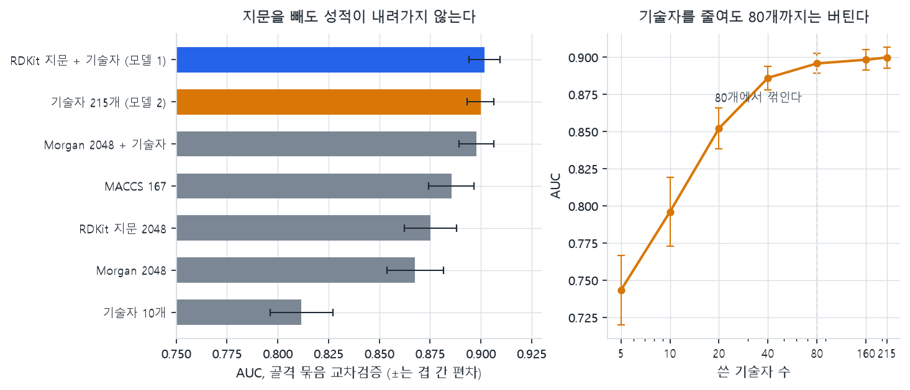
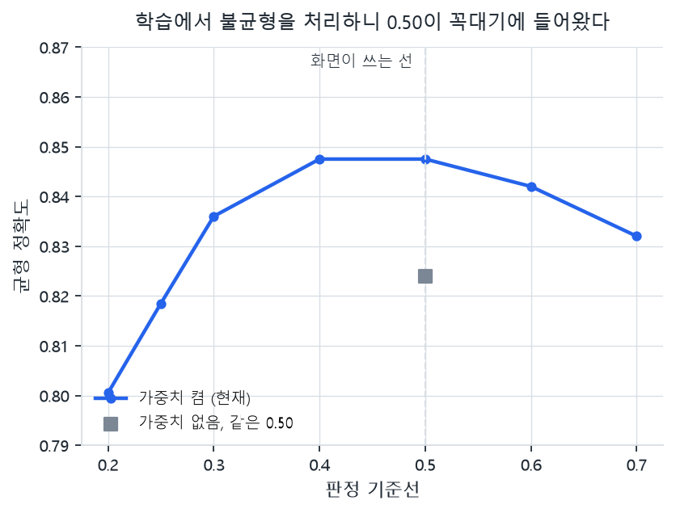
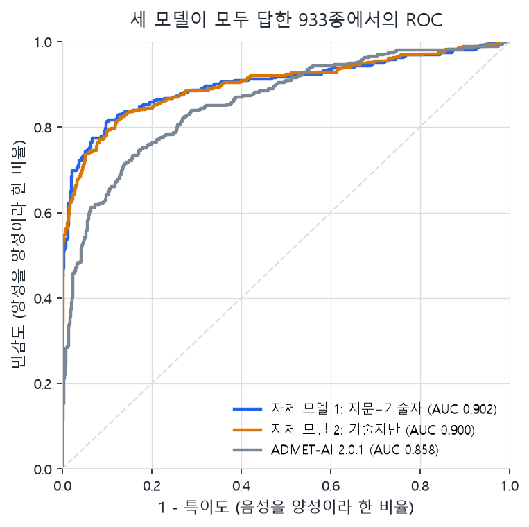
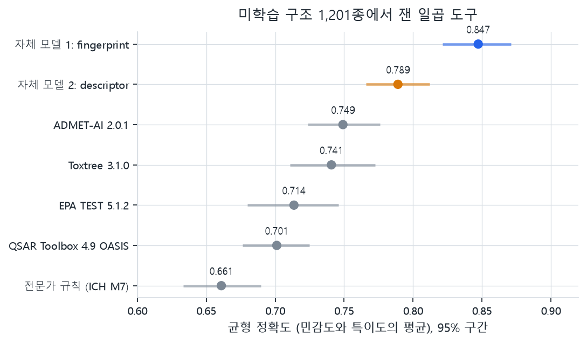
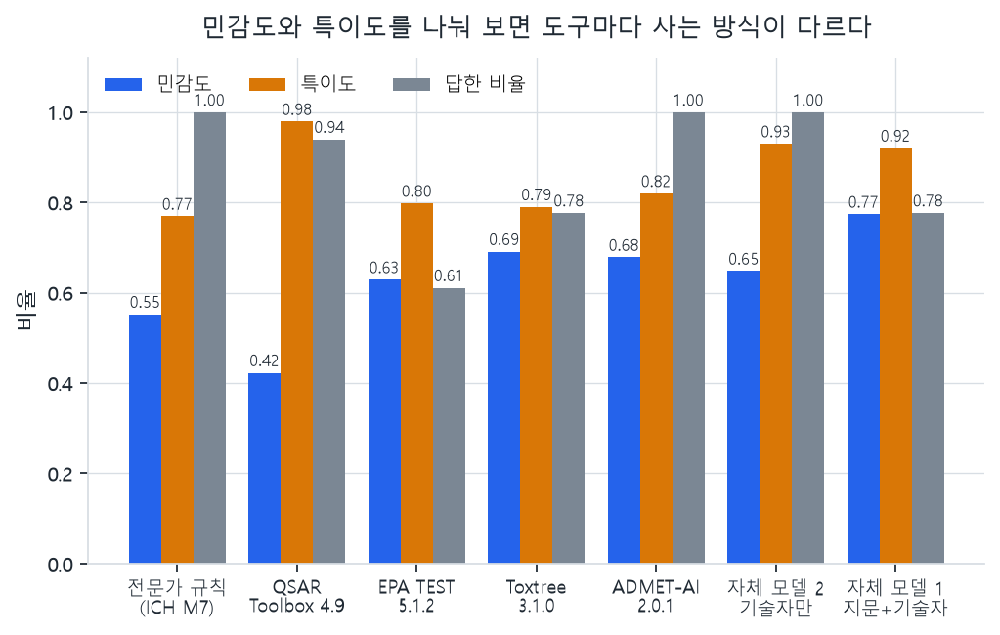
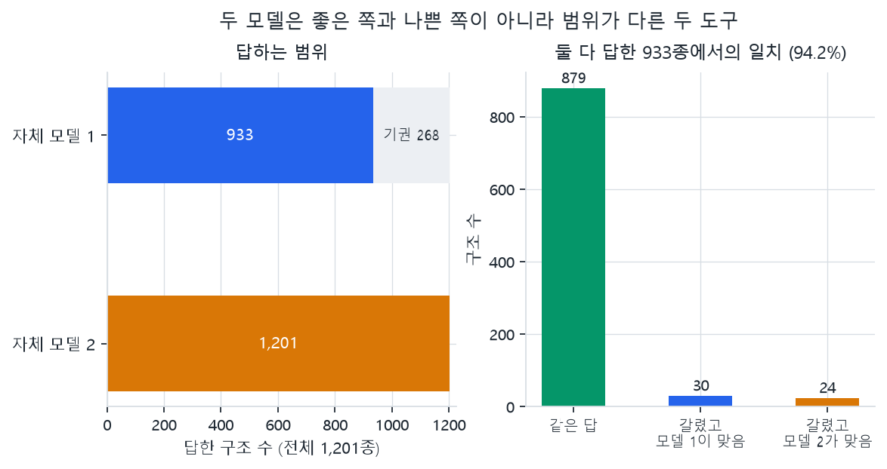

# 자체 Ames 변이원성 예측 모델 두 개의 개발 과정

작성 2026-11-08. 여기 적힌 수치는 전부 저장소에 남아 있는 측정 파일에서 나왔다.
재현에 필요한 파일 경로를 각 절 끝에 적었다. 측정하지 않은 값은 적지 않았다.

그림을 다시 그리려면:

```bash
external_tools/ames-env/Scripts/python.exe -I -X utf8 evaluation/scripts/build_model_development_figures.py
```

---

## 1. 두 모델의 요약

| | 자체 모델 1 | 자체 모델 2 |
|---|---|---|
| 쓰는 재료 | RDKit 분자지문 2,048비트 + 2D 기술자 | 2D 기술자 215개만 |
| 특징 열 수 | 2,263 | 215 |
| 알고리즘 | XGBoost | XGBoost |
| 학습 구조 | 19,963 | 19,963 |
| 판정 기준선 | 0.50 | 0.50 |
| 균형 정확도 | **0.847** [0.821, 0.871] | 0.789 [0.766, 0.812] |
| ROC-AUC | **0.902** [0.879, 0.924] | 0.833 [0.808, 0.859] |
| 답한 비율 | 77.7% | **100%** |
| 저장 위치 | `models/ames_xgboost_balanced` | `models/ames_descriptors_balanced` |

두 모델은 좋은 쪽과 나쁜 쪽이 아니다. **적용 범위가 다르다.** 모델 1이 못 읽는
염, 혼합물, 무기물을 모델 2가 읽는다. 자세한 것은 7절에 있다.

---

## 2. 학습 자료

### 2.1 모은 것

공개 데이터베이스와 문헌에서 Ames 시험 기록 **355,009행**을 모았다. 출처는 25개이고
많은 쪽부터 CCRIS 67,966행, Karamertzanis 2025 보충자료 53,881행, QSAR Toolbox의
ISSSTY 38,255행, OASIS 유전독성 31,800행, EPA 2021 25,609행이다.

### 2.2 걸러낸 것

| | 행 수 |
|---|---|
| 원본 | 355,009 |
| in vitro 이진 판정만 남김 | 349,058 |
| 구조가 살아남은 기록 | 273,568 |
| 서로 다른 정확한 구조 | 23,601종 |
| 근거 투표를 묶은 뒤 후보 구조 | 23,160종 |

중간에서 뺀 것은 endpoint가 충돌하는 193행, QSAR Toolbox가 다시 실은 37,339행,
그리고 구조를 읽지 못한 38,151행이다. 구조를 못 읽은 쪽의 내역은 SMILES 없음 32,487,
무기물 2,956, 유기 성분이 여럿인 것 1,676, SMILES 해석 실패 943, 나머지 89다.

구조 식별은 RDKit으로 원자 맵을 떼고 canonical isomeric SMILES를 만들어 맞췄다.
**염, 전하, 호변이성체를 자동으로 합치지 않았다.** 합치면 서로 다른 실험 기록이
한 구조에 섞인다.

### 2.3 라벨을 정하는 규칙

같은 구조에 여러 기록이 있으면 근거를 묶어 다수결로 정한다. 다수 판정의 비율이
**70% 이상**일 때만 라벨로 썼다. 상충하는 근거 단위가 2,082개, 정확히 반반인 구조가
398개 있었고 이것들은 라벨 없이 남겼다.

70%를 고른 이유는 올려도 나아지지 않기 때문이다. 골격 묶음 교차검증으로 쟀다.

| 합의율 기준 | 남는 구조 | AUC | 겹 간 편차 |
|---|---|---|---|
| 70% (현재) | 19,963 | 0.9018 | 0.0075 |
| 80% | 19,472 | 0.9070 | 0.0115 |
| 90% | 18,909 | 0.9070 | 0.0146 |
| 100% | 18,583 | 0.9079 | 0.0104 |

100%까지 올려 얻는 것이 0.006이고 잃는 구조가 1,380개다. 편차가 오히려 커진다.
그리고 기준마다 남은 구조에서만 채점하므로, 올라간 값이 모델이 좋아진 것인지 남은
문제가 쉬워진 것인지 구분되지 않는다.

### 2.4 나눈 것

| 분할 | 구조 수 | 쓰임 |
|---|---|---|
| train | 17,717 (양성 5,347) | 학습 |
| validation | 2,246 (양성 687) | 학습 |
| test (잠금) | 2,194 | 이 작업에서 열지 않음 |
| 합계 | **22,157** | |

최종 두 모델은 train과 validation을 합친 **19,963종**으로 학습했다. 양성 비율은
**30.2%**다.

분할은 구조 family 단위로 했고, **분할 사이에 같은 family가 하나도 없다**
(`structural_family_overlap_between_partitions: 0`).

> 파일: `data/ames/preprocessing_summary.json`, `data/ames/train_model_ready_70.csv`,
> `data/ames/validation_model_ready_70.csv`, `data/ames/test_model_ready_70_LOCKED.csv`

---

## 3. 쓴 특징(feature)

### 3.1 자체 모델 1

두 덩어리를 이어 붙였다.

- **RDKit 분자지문 2,048비트.** 분자 안의 부분 경로를 해시해 켜고 끄는 비트열이다.
  비트 하나에 사람이 읽을 이름이 없다.
- **RDKit 2D 기술자 전체.** 분자량, MolLogP, TPSA, 고리 수 같은 물성값과
  `fr_epoxide`, `fr_nitro_arom`, `fr_nitroso` 같은 작용기 개수다.

합쳐서 2,265열이고, 학습 자료에서 값이 변하지 않는 2열을 빼 **2,263열**을 썼다.

### 3.2 자체 모델 2

**기술자 215개만** 쓴다. 지문을 쓰지 않는다. 열 목록을 가중치와 함께 저장한다.
변하지 않는 열이 어느 것인지는 가진 행에 따라 달라지므로, 예측할 때 다시 계산하면
학습할 때와 다른 특징을 만들게 된다.

### 3.3 왜 모델 2는 지문을 뺐는가



골격 묶음 교차검증으로 feature 구성 열 가지를 비교했다. 알고리즘은 XGBoost로 고정했다.

| feature | 열 수 | AUC | 편차 |
|---|---|---|---|
| RDKit 지문 + 기술자 전체 (모델 1) | 2,263 | **0.9018** | 0.0075 |
| 기술자 전체만 (모델 2) | 215 | **0.8999** | 0.0066 |
| Morgan 2048 + 기술자 전체 | 2,263 | 0.8978 | 0.0086 |
| MACCS 167 | 167 | 0.8855 | 0.0111 |
| RDKit 지문 2048만 | 2,048 | 0.8752 | 0.0128 |
| Morgan 2048만 | 2,048 | 0.8676 | 0.0139 |
| 기술자 10개 | 10 | 0.8117 | 0.0155 |

**지문 2,048비트가 더해 주는 것이 0.0019다.** 겹 간 편차가 ±0.007이므로 차이가
아니다. 열 수는 10배 차이난다.

지문을 뺀 진짜 이유는 성능이 아니라 **설명**이다. 예측 하나하나에 대해 어느 열이
얼마나 밀었는지(log-odds 기여도) 계산해 봤다.

| 물질 | 모델 1의 지문 덩어리 | 모델 1의 이름 있는 기술자 전체 | 모델 2의 1순위 열 |
|---|---|---|---|
| 에틸렌옥사이드 | **+3.074** | +0.006 | `fr_epoxide` +1.852 |
| 에탄올 | **-2.744** | -0.065 | `BCUT2D_CHGLO` +0.201 |

**두 표현을 함께 주면 모델은 지문만 쓴다.** 기술자 215개가 혼자서는 0.8999를 내는데,
지문과 같이 넣으면 판정 기여도가 거의 0이 된다. 정보가 서로 대체 가능하고 모델이
한쪽을 골라 쓰는 것이다. 그래서 모델 1은 "왜 그렇게 봤는가"에 답하지 못한다.
모델 2는 에폭사이드 고리가 있다는 것을 1순위 이유로 내놓는다.

기술자를 더 줄일 수 있는지도 쟀다. 각 겹의 학습 부분에서만 중요도 순위를 매겨
고른 것이라 시험 부분을 보고 고른 값이 아니다.

| 쓴 기술자 수 | 5 | 10 | 20 | 40 | **80** | 160 | 215 |
|---|---|---|---|---|---|---|---|
| AUC | 0.743 | 0.796 | 0.852 | 0.886 | **0.896** | 0.898 | 0.900 |

**80개에서 꺾인다.** 80개와 215개 전체의 차이가 0.004로 편차 안이다. 현재 모델은
215개 전체를 쓰고 있고, 더 가볍게 만들 여지가 남아 있다.

> 파일: `ames/results/ames_sweep_features_scaffold.json`,
> `ames/results/ames_descriptors_scaffold.json`, `ames/results/ames_why_redundancy.json`

---

## 4. 알고리즘

다섯 가지를 같은 feature에서 비교했다.

| 알고리즘 | AUC | 편차 | 학습 시간 |
|---|---|---|---|
| **XGBoost** | **0.9018** | 0.0075 | 81초 |
| 히스토그램 부스팅 | 0.8983 | 0.0068 | 247초 |
| 랜덤포레스트 | 0.8916 | 0.0104 | 70초 |
| 엑스트라트리 | 0.8826 | 0.0104 | 129초 |
| 로지스틱 회귀 | 0.8160 | 0.0137 | 44초 |

XGBoost와 히스토그램 부스팅의 차이 0.0035는 편차 안이지만 시간이 3배 걸린다.
선형 모델과의 차이 0.086은 편차보다 훨씬 크다.

두 모델이 쓰는 설정은 같다.

| | 값 |
|---|---|
| n_estimators | 400 |
| max_depth | 6 |
| learning_rate | 0.0678 |
| subsample | 0.9935 |
| colsample_bytree | 0.6552 |
| reg_lambda | 0.1 |
| min_child_weight | 1.1822 |
| scale_pos_weight | 2.3084 (모델 1) / 2.3080 (모델 2) |
| seed | 20261105 (모델 1) / 20261106 (모델 2) |
| RDKit | 2026.03.4 |

> 파일: `ames/results/ames_sweep_algorithms_scaffold.json`,
> `models/ames_xgboost_balanced/model_spec.json`,
> `models/ames_descriptors_balanced/model_spec.json`

---

## 5. 설계 판단 세 가지

### 5.1 묶음 기준을 골격으로 바꿨다

받은 자료는 `leakage_group`(모체 구조 기준)으로 나뉘어 있었다. 이 저장소의 다른
모델은 Bemis-Murcko 골격으로 묶는다. 둘을 세어 보니 포개지지 않는다.

| | 묶음 수 | 가장 큰 묶음 | 1개짜리 묶음 |
|---|---|---|---|
| leakage_group | 15,132 | 14개 | 60.7% |
| 골격 | 8,422 | 2,601개 | 32.7% |

**여러 leakage_group에 걸친 골격이 1,245개이고 거기 속한 구조가 11,795개로 전체의
59.1%다.** leakage_group으로 나누면 과반의 구조에 대해 같은 골격의 유사체가 학습과
평가 양쪽에 들어간다.

| 묶음 기준 | AUC | 편차 |
|---|---|---|
| leakage_group | 0.9171 | 0.0074 |
| **골격** | **0.9018** | 0.0075 |

**0.0153 내려간다.** 편차가 ±0.007이므로 이 차이는 그 두 배가 넘는다. 두 숫자 모두
틀리지 않았다. **처음 보는 골격에 적용할 때 기대할 값이 0.90이고, 알려진 골격의
변형에 적용할 때가 0.92다.** 보고서에는 둘을 함께 적고 어느 조건인지 밝히는 것이
정직하다.

### 5.2 성적을 읽을 수 있는지 먼저 확인했다

| | AUC |
|---|---|
| 무작위 기준선 | 0.504 ± 0.007 |
| 라벨을 뒤섞었을 때 | 0.501 |
| 실제 | 0.902 ± 0.008 |

라벨을 뒤섞으면 성적이 사라진다. **잡음 바닥의 흔들림이 ±0.007이므로 여기서는
0.01 차이도 읽을 수 있다.**

### 5.3 불균형을 기준선이 아니라 학습 가중치로 처리했다



공개 Ames 벤치마크는 양성이 거의 절반이다. TDC AMES 54.6%, Hansen 2009 53.8%.
**우리 자료는 30.2%다.** 그래서 0.50이 균형점에 떨어지지 않는다.

처음에는 기준선을 0.25로 내려서 썼는데, 이것은 관행에서 벗어난다. 대신 학습 단계에서
`scale_pos_weight = 0.6977 / 0.3023 = 2.308`을 켜고 기준선을 0.50에 두는 쪽으로
바꿨다. 독립 자료 933종에서 잰 결과다.

| 학습본 | 기준선 | 민감도 | 특이도 | 균형 정확도 | AUC |
|---|---|---|---|---|---|
| 가중치 없음 | 0.50 | 0.698 | 0.950 | 0.824 | 0.8966 |
| 가중치 없음 | 0.25 (손으로 고름) | 0.816 | 0.865 | 0.841 | 0.8966 |
| **가중치 켬** | **0.50** | **0.774** | **0.921** | **0.847** | **0.9021** |

가중치를 켜고 0.50을 쓰는 쪽이, 가중치 없이 기준선을 손으로 고른 쪽보다 높다.
AUC가 거의 같으므로 순위가 달라진 것이 아니라 점수 척도가 옮겨진 것이다.

기준선별로 보면 꼭대기가 평평하다. 0.40과 0.50이 같은 0.847이고, 자체 균형점인
0.43에서도 0.857로 0.010 차이뿐이다. **기준선을 옮겨 얻을 것이 거의 없다.**

기술자 모델에도 같은 처리를 했다(`scale_pos_weight` 2.3080). 0.50에서의 0.789가
가중치 없는 학습본을 0.25에 놓았을 때의 0.787과 같은 수준이다. 기준선을 옮기지 않고
같은 성능을 얻었다.

AmesFormer가 공개한 코드가 같은 방식이다. 0.5를 고정하고 학습 손실에 클래스 가중치를
준다. ICH M7 본문과 QMRF v1.2에는 점수 기준선에 대한 언급이 없다.

> 파일: `ames/results/ames_why_grouping.json`, `ames/results/ames_why_calibration.json`,
> `ames/results/ames_why_calibration_balanced.json`,
> `ames/results/ames_why_calibration_descriptors.json`

---

## 6. 평가 자료

학습에 쓴 자료로 채점하면 자기 답안을 다시 맞히는 것이다. 겹치지 않는 자료를 따로
만들었다.

- 원자료: MutagenLou2023 (Hugging Face, CC BY 4.0), 후보 10,045행
- TDC 유래 자료와 구조가 겹쳐 제외: 6,890행
- 중복 제외: 64행
- 남은 것: **3,091종**
- 여기서 다시 **자체 모델의 학습·검증에 쓰인 1,890종을 뺀 1,201종**이 최종 평가 자료다
  (양성 429, 음성 772)

**이 1,201종은 두 모델이 한 번도 본 적 없는 구조다.** 아래 성능 수치는 전부 여기서
나왔다.

> 파일: `evaluation/results/ames_independent_unseen.csv`,
> `evaluation/results/ames_independent_manifest.json`,
> `evaluation/scripts/build_independent_set.py`

---

## 7. 성능

### 7.1 ROC



모델 1이 1,201종 중 268종을 기권하므로, 각자 답한 행으로 그린 곡선은 서로 다른
질문에 대한 답이 된다. **세 모델이 모두 답한 933종**에서 그렸다.

| 모델 | AUC (933종) |
|---|---|
| 자체 모델 1 | 0.902 |
| 자체 모델 2 | 0.900 |
| ADMET-AI 2.0.1 | 0.858 |

같은 행에서 재면 **두 자체 모델의 AUC는 사실상 같다.** 1절 표에서 모델 2의 AUC가
0.833인 것은 1,201종 전부에서 잰 값이고, 모델 1이 기권한 268종이 어려운 구조이기
때문이다. 모델 1의 기권은 무작위가 아니다.

### 7.2 일곱 도구 비교



구간은 같은 구조를 다시 뽑아 2,000번 계산한 95% 백분위 구간이다. 다른 물질에서도
같은 값이 나온다는 뜻이 아니라, **이만큼은 운으로도 움직인다**는 뜻이다.

| 도구 | 균형 정확도 | 95% 구간 | 답한 비율 |
|---|---|---|---|
| 자체 모델 1 | **0.847** | 0.821 - 0.871 | 0.777 |
| 자체 모델 2 | 0.789 | 0.766 - 0.812 | 1.000 |
| ADMET-AI 2.0.1 | 0.749 | 0.723 - 0.776 | 1.000 |
| Toxtree 3.1.0 | 0.741 | 0.711 - 0.773 | 0.777 |
| EPA TEST 5.1.2 | 0.714 | 0.680 - 0.746 | 0.611 |
| QSAR Toolbox 4.9 OASIS | 0.701 | 0.676 - 0.725 | 0.940 |
| 전문가 규칙 (ICH M7) | 0.661 | 0.633 - 0.689 | 1.000 |

**ADMET-AI와 Toxtree의 구간은 거의 완전히 겹친다.** 표의 순서를 순위로 읽으면 안
되는 자리가 여기다. 자체 모델 1과 그 아래는 겹치지 않으므로 그 차이는 실재한다.

### 7.3 민감도와 특이도



균형 정확도는 평균이라 어느 쪽으로 번 점수인지를 가린다.

| 도구 | 민감도 | 특이도 |
|---|---|---|
| 자체 모델 1 | **0.774** | 0.921 |
| 자체 모델 2 | 0.648 | **0.930** |
| ADMET-AI 2.0.1 | 0.678 | 0.820 |
| Toxtree 3.1.0 | 0.691 | 0.790 |
| QSAR Toolbox 4.9 OASIS | 0.423 | **0.979** |
| 전문가 규칙 (ICH M7) | 0.552 | 0.769 |

QSAR Toolbox는 특이도 0.979로 가장 높은데 민감도가 0.423이다. **양성 열 개 중 여섯
개를 놓친다.** 선별 도구에서는 놓치는 쪽이 더 비싸다.

---

## 8. 두 모델을 같이 두는 이유



### 8.1 모델 1은 왜 22%를 기권하는가

적용 범위를 따져 사양한 것이 아니라 **구조를 읽지 못한 것이다.** 분자지문을 만들지
못해 특징 벡터 자체가 나오지 않는다.

| 사유 | 건수 |
|---|---|
| `multiple_organic_components` (염, 혼합물) | 166 |
| `inorganic` (무기물) | 96 |
| `over_300_heavy_atoms` | 4 |
| `unsupported_parent_standardization` | 2 |
| 합계 | **268** |

### 8.2 모델 2가 메우는 것

| 측정 | 값 |
|---|---|
| 모델 1이 기권하고 모델 2가 답한 구조 | 268개 |
| 그중 모델 2가 맞힌 것 | **195개 (72.8%)** |
| 둘 다 답한 구조 | 933개 |
| 그중 두 모델이 같은 답 | 879개 (**94.2%**) |
| 갈린 54개 중 모델 1이 맞은 것 | 30 |
| 갈린 54개 중 모델 2가 맞은 것 | 24 |

**겹치는 78%에서는 모델 2가 거의 아무것도 더하지 않는다.** 94.2%가 같은 답이고,
갈리는 54건은 30 대 24로 거의 반반이다. 이 영역만 보면 모델 2는 중복이다.

**안 겹치는 22%에서는 모델 2만 답한다.** 염, 혼합물, 무기물이 들어간 경로에서는
모델 1 칸이 통째로 비고, 자체 모델 중 답을 내는 것은 모델 2뿐이다. 그 영역에서의
정확도 72.8%는 전체 0.789보다 낮지만, 비교 대상은 "답이 없음"이다.

소프트웨어는 둘 중 누가 맞는지 정하지 않는다. 둘 다 보여준다.

### 8.3 세 모델의 점수를 평균하면 더 오른다

두 자체 모델과 ADMET-AI는 모두 점수를 돌려준다. 그냥 평균했다. 적합하는 과정이 없고
기준선도 0.50 그대로다.

| | 균형 정확도 | AUC |
|---|---|---|
| 자체 모델 1 (단일 최고) | 0.847 | 0.902 |
| **세 모델 점수 평균** | **0.864** [0.841, 0.887] | **0.916** [0.894, 0.936] |

AUC 차이 +0.013이고 구간이 0을 넘지 않는다. 1,201종을 절반으로 갈라 한쪽에서 자른
지점을 고르고 다른 쪽에서 재도 0.869와 0.868이 나온다.

> 파일: `evaluation/results/tool_panel_wide.json`,
> `evaluation/scripts/evaluate_tool_panel.py`

---

## 9. 한계

1. **계열마다 성적이 크게 다르다.** 구조 100개 이상인 골격 계열만 봐도 퓨란 0.970,
   퀴놀린 0.766으로 퍼져 있고 중앙값이 0.885다. "이 모델의 정확도는 0.90이다"라는
   문장은 계열에 따라 0.72일 수도 0.97일 수도 있다는 뜻이다.
2. **학습 구조와 닮은 것만 잘 맞힌다.** 학습 구조와의 유사도 0.70 이상에서 AUC
   0.965, 0.30 미만에서 0.823이다. 유사도 중앙값은 0.519다.
3. **점수는 확률이 아니다.** 0.92가 92%의 확률이라는 뜻이 아니고, 0.50은 규제상
   안전선이 아니다.
4. **겹침을 완전히 제거하지 못했다.** 구조 동일성을 정규 SMILES로 판정했으므로 염,
   호변이성체, 입체이성체가 다른 형태로 남아 있는 겹침은 검출되지 않는다.
5. **라벨을 직접 검증하지 않았다.** 원 수집본의 판정을 그대로 썼다.
6. **음성 예측은 선별 결과이지 안전성의 근거가 아니다.** 기권과 적용 범위 밖도
   음성이 아니다.
7. **잠긴 시험 분할 2,194종은 아직 열지 않았다.** 위 수치는 전부 별도로 구성한
   독립 자료에서 나왔다.
